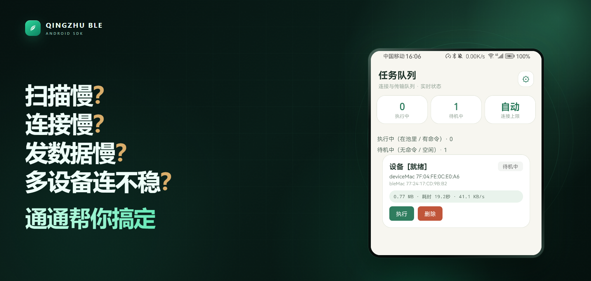
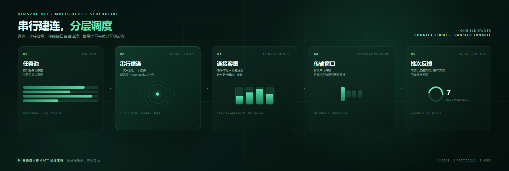

### [下载试玩（1 个主端 + 2 个从端）](#下载试玩) · [在线文档](https://qingzhu-ai-public.github.io/qingzhu-ble-android/)（[接入指南](https://qingzhu-ai-public.github.io/qingzhu-ble-android/index.html?view=guide) · [架构全景](https://qingzhu-ai-public.github.io/qingzhu-ble-android/index.html?view=arch)） · 具体实现思路看文章《[AI 时代，如何做一个生产级 Android BLE SDK ？](https://qingzhu-ai-public.github.io/qingzhu-blue/#android/experience/from-runnable-to-production)》

> Fullstack 教学基线源码：[reference/fullstack](reference/fullstack)（独立参考工程，不参与主 SDK 构建）。

# Qingzhu-BLE

[](https://developer.android.com)
[](https://gradle.org)
[](https://github.com/qingzhu-ai-public/qingzhu-ble-android)

青竹 BLE Android SDK，以任务为中心，提供扫描、自动寻人、连接、发送、命令排队、取消与删除、超时重试和协议插件化能力；内部处理串行建连、传输窗口、地址轮换、心跳、断连恢复和迟到回调，可注册自己的设备协议。

> **你只需要把现有产品的设备协议告诉 AI，让它帮你接入 `ProtocolPlugin`。**
>
> 扫描、连接、服务发现、GATT 收发、超时、重试、命令队列、多设备调度和异常恢复，底层已经处理好。你不需要再为每个产品重写一套 BLE 状态机。
>
> 给 AI 协议文档、帧格式、抓包或示例数据即可，不要让它猜协议。具体提示词见 [用 AI 接入](#0-用-ai-接入推荐先做)。

## 为什么做这套 SDK

写一个能跑的 BLE Demo 并不难：

```text
Scan → Connect → Discover Services → Write → Notify
```

但这只证明“一台手机、一台设备、一次理想操作”能跑通。进入真实项目后，问题会从另一层开始出现：多台设备同时连接、页面反复点击、设备休眠或换地址、任务中途取消、蓝牙栈返回 133/8/19、不同机型的行为差异，以及长时间运行后的资源泄漏。

大型 BLE 项目还有第二层问题：多套设备 SDK 并存。每套 SDK 都自带扫描、连接、重试、队列和错误模型，各自以为独占蓝牙资源；结果是重复实现、状态不一致、修复分散，而且新设备一接入就要再复制一套公共逻辑。

Qingzhu-BLE 的出发点不是再写一个薄封装，而是把这两类问题放进同一套架构里：

| 设计理念 | 解决的问题 |
|---|---|
| **任务式模型** | 业务只表达“这台设备要做什么”，SDK 管扫描、寻人、排队、连接、发送、取消、重试和收尾 |
| **统一资源调度** | 一个内核拥有扫描、建连、连接容量和传输窗口；串行建连、多设备调度和迟到回调治理有唯一落脚点 |
| **异常治理** | 处理地址轮换、扫描假死、心跳失活、断连恢复、超时重试、取消后的旧回调污染 |
| **协议插件化** | 公共能力下沉到 core，设备差异上浮为协议插件；新增协议不改内核 |
| **可诊断性** | 任务自带状态、进度、结果、错误，每条命令都有最终结果和失败阶段，排查时知道卡在哪一步 |

这套设计的前提可以用一句话概括：

> BLE 资源在一个进程里是共享的，必须有明确的所有者；否则任何调度策略都无法生效。

因此它不是“又一个 BLE API 复制品”，而是一个面向多设备通信和多协议治理的工程化 SDK 实验。

当前仓库仍是源码预览版：核心状态机和公开示例协议已经可构建、可测试，但长期稳定性、机型兼容性和多插件冲突治理仍需继续验证。

## 架构总览


> 一个 BLE 所有者，多种协议。公共能力收进 core，设备差异下沉到协议插件。

## 目录

- [为什么做这套 SDK](#为什么做这套-sdk)
- [架构总览](#架构总览)
- [下载试玩](#下载试玩)
  - [试玩 App 源码](#试玩-app-源码)
- [API](#api)
- [接入前提示](#接入前提示)
- [接入文档](#接入文档)
  - [0. 用 AI 接入](#0-用-ai-接入推荐先做)
  - [1. 添加依赖](#1-添加依赖)
  - [2. 配置权限](#2-配置权限)
  - [3. 初始化](#3-初始化)
  - [4. 扫描](#4-扫描)
  - [5. 创建任务](#5-创建任务)
  - [6. 连接](#6-连接)
  - [7. 发送数据](#7-发送数据)
  - [8. 任务状态与结果](#8-任务状态与结果)
  - [9. 命令排队](#9-命令排队)
  - [10. 取消与删除](#10-取消与删除)
  - [11. 多设备调度](#11-多设备调度)
  - [12. 自定义协议](#12-自定义协议)
- [附录 A：命令模型与 Builder](#附录-a命令模型与-builder真实-api)
- [构建](#构建)
  - [Fullstack 参考源码](#fullstack-参考源码)
- [测试](#测试)
- [Screenshot](#screenshot)
- [常见问题](#常见问题)
- [版本](#版本)
- [License](#license)

## 下载试玩

| 角色 | 文件 | 说明 |
|---|---|---|
| 主端 | [qingzhu-demo-main-v1.0-debug.apk](downloads/qingzhu-demo-main-v1.0-debug.apk) | 扫描、添加任务、连接、发送、命令排队、调度配置 |
| 从端 | [qingzhu-demo-sim-generic-v1.0-debug.apk](downloads/qingzhu-demo-sim-generic-v1.0-debug.apk) | Generic 可编程外设，任意广播 + echo GATT |
| 从端 | [qingzhu-demo-sim-eddystone-v1.0-debug.apk](downloads/qingzhu-demo-sim-eddystone-v1.0-debug.apk) | Eddystone Beacon + 可连接 GATT 外设 |
| 校验 | [SHA256SUMS.txt](downloads/SHA256SUMS.txt) | 3 个 APK 的 SHA256 |

三个 APK 都是 Debug 签名，Android 7.0+。

```bash
adb install -r downloads/qingzhu-demo-main-v1.0-debug.apk
adb install -r downloads/qingzhu-demo-sim-generic-v1.0-debug.apk
adb install -r downloads/qingzhu-demo-sim-eddystone-v1.0-debug.apk
```

试玩方式：

1. 主端装在手机 A；
2. 手机 B 装 Generic 或 Eddystone 从端，两个都装也可以；
3. 从端开启广播；
4. 主端扫描、连接、发送。

试玩包只装配 Generic 和 Eddystone 两个开源协议，不包含私有设备协议。

### 试玩 App 源码

| 角色 | 源码模块 |
|---|---|
| 主端 | [`qingzhu-demo-main`](qingzhu-demo-main) |
| Generic 从端 | [`qingzhu-demo-sim-generic`](qingzhu-demo-sim-generic) |
| Eddystone 从端 | [`qingzhu-demo-sim-eddystone`](qingzhu-demo-sim-eddystone) |

从端 App 不依赖 SDK，完全用 Android BLE API 模拟真实外设。

## API

* **[QingzhuSdk](qingzhu-company-sdk/src/main/java/com/qingzhu/sdk/QingzhuSdk.java)** - 开源门面，提供初始化、扫描、任务创建/查询/删除、全局任务观察、调度配置和协议注册。
* **[QDevice](qingzhu-core/src/main/java/com/qingzhu/ble/sdk/core/device/QDevice.java)** - 扫描到的设备模型，包含 MAC、名称、RSSI、稳定身份、协议类型和 metadata。
* **[QCommand](qingzhu-core/src/main/java/com/qingzhu/ble/sdk/core/api/QCommand.java)** - 连接/发送命令，支持 JSON、字节、多附件、保持连接、发完断开和重连策略。
* **[QTask](qingzhu-core/src/main/java/com/qingzhu/ble/sdk/core/api/QTask.java)** - 任务句柄，一台设备对应一个任务，提供发送、连接、断开、取消、删除、状态观察和连接参数设置。
* **[TaskResult](qingzhu-core/src/main/java/com/qingzhu/ble/sdk/core/api/TaskResult.java)** / **[TaskStage](qingzhu-core/src/main/java/com/qingzhu/ble/sdk/core/api/TaskStage.java)** - 单条命令的最终结果，以及失败所处的阶段。
* **[TaskSnapshot](qingzhu-core/src/main/java/com/qingzhu/ble/sdk/core/api/TaskSnapshot.java)** - 任务的不可变快照，供 `observeAll` / `observe` 回调。
* **[TaskState](qingzhu-core/src/main/java/com/qingzhu/ble/sdk/core/api/TaskState.java)** - 任务状态。
* **[Subscription](qingzhu-core/src/main/java/com/qingzhu/ble/sdk/core/api/Subscription.java)** - 订阅句柄，可提前取消。
* **[ProtocolPlugin](qingzhu-core/src/main/java/com/qingzhu/ble/sdk/core/protocol/ProtocolPlugin.java)** - 协议插件接口，新设备类型通过它接入。

## 接入前提示

1. 设备只有一种类型：实现一个 `ProtocolPlugin`，初始化后注册即可。
2. 设备有多种类型：每种设备一个插件，扫描结果通过 `device.getProtocolType()` 区分。
3. 只给 MAC 也能创建任务：SDK 会先扫描寻人，找到后自动连接和发送。
4. 同一台设备同一时刻只有一个有效任务：`createTask` 会替换已有任务，需要复用时用 `getTask`。

## 接入文档

### 0. 用 AI 接入（推荐先做）

这是一个源码预览仓库，推荐先把工程拉到本地，再让 AI 读代码和 README，最后接入你的 App。

#### 克隆项目

```bash
git clone https://github.com/qingzhu-ai-public/qingzhu-ble-android.git
cd qingzhu-ble-android
```

#### 理解项目的提示词

复制到 Codex / Claude Code / Cursor / CodeBuddy 等工具：

```text
你是 Android BLE 工程师。请先不要修改代码，只阅读并理解这个仓库：
https://github.com/qingzhu-ai-public/qingzhu-ble-android

请按顺序阅读：
1. README 的「为什么做这套 SDK」「架构总览」「API」「接入文档」
2. qingzhu-company-sdk/src/main/java/com/qingzhu/sdk/QingzhuSdk.java
3. qingzhu-core/src/main/java/com/qingzhu/ble/sdk/core/api/QTask.java
4. qingzhu-core/src/main/java/com/qingzhu/ble/sdk/core/api/QCommand.java
5. qingzhu-core/src/main/java/com/qingzhu/ble/sdk/core/protocol/ProtocolPlugin.java
6. qingzhu-core/src/main/java/com/qingzhu/ble/sdk/core/QSdk.java

读完后用不超过 800 字回答：
- 这个 SDK 解决什么问题
- core、门面、协议插件分别负责什么
- 扫描、提交任务、连接、发送的调用顺序
- 接入一个自有设备协议时必须实现哪些方法
- 哪些能力已经实现，哪些仍是边界

不要先写代码，不要改公开仓库，先输出理解结果。
```

#### AI 阅读顺序

```text
README
  → QingzhuSdk（门面 API）
  → QTask / QCommand（任务和命令）
  → ProtocolPlugin（协议扩展）
  → QSdk（扫描、任务创建、观察者）
  → QTaskPool（命令排队、状态机、重试）
```

### 1. 添加依赖

源码模块接入：

```groovy
// settings.gradle
include ':qingzhu-core'
include ':qingzhu-company-sdk'
include ':qingzhu-protocol-generic'
include ':qingzhu-protocol-eddystone'
```

```groovy
// app/build.gradle
dependencies {
    implementation project(':qingzhu-company-sdk')
}
```

本地 AAR 接入：

> 当前公开仓库只提供源码模块接入和试玩 APK；宿主 AAR 由内部工程打包，不在公开仓库发布。
>
> `qingzhu-company-sdk` 是唯一源码门面。

### 2. 配置权限

```xml
<uses-permission android:name="android.permission.BLUETOOTH_SCAN" />
<uses-permission android:name="android.permission.BLUETOOTH_CONNECT" />
<uses-permission android:name="android.permission.BLUETOOTH" android:maxSdkVersion="30" />
<uses-permission android:name="android.permission.BLUETOOTH_ADMIN" android:maxSdkVersion="30" />
<uses-permission android:name="android.permission.ACCESS_FINE_LOCATION" />
<uses-permission android:name="android.permission.ACCESS_COARSE_LOCATION" />
<uses-permission android:name="android.permission.WAKE_LOCK" />
```

Android 12 及以上动态申请 `BLUETOOTH_SCAN` 和 `BLUETOOTH_CONNECT`；Android 11 及以下通常需要定位权限并打开系统定位。

### 3. 初始化

```java
public class App extends Application {
    @Override
    public void onCreate() {
        super.onCreate();
        QingzhuSdk.init(this);
    }
}
```

`init()` 会初始化内核并注册 Generic、Eddystone 两个开源协议，重复调用幂等。

### 4. 扫描

```java
QingzhuSdk.startScan(new QSdk.ScanListener() {
    @Override
    public void onDevices(List<QDevice> devices) {
        for (QDevice device : devices) {
            String name = device.getName();
            String mac = device.getMac();
            String stableId = device.getStableId();
            int rssi = device.getRssi();
            String protocol = device.getProtocolType().getId();
        }
    }

    @Override
    public void onScanFailed(int errorCode, String message) {
        // 权限、蓝牙关闭或系统扫描失败
    }

    @Override
    public void onScanStopped(List<QDevice> devices) {
        // 定时扫描结束时的最终快照
    }
});
```

列表去重请使用 `getStableId()`，不要只依赖 MAC。地址轮换设备只有稳定身份不变。

扫描设置：

```java
QingzhuSdk.startScan(
        ScanOptions.builder()
                .setTimeoutMs(30_000)       // 30 秒后自动停止；0 = 持续扫描
                .setMinRssi(-80)             // 忽略更弱的设备
                .setNamePrefix("ESL")        // 名称前缀，大小写不敏感
                .addProtocol("generic")      // 只显示指定协议
                .addStableId("A1B2C3D4E5F6") // 只显示指定稳定身份
                .build(),
        listener
);
```

过滤只作用于 UI 回调，任务池仍然能看到完整广播，不影响自动寻人和重寻址。

停止扫描：

```java
QingzhuSdk.stopScan();      // 退订 UI 回调并停止底层扫描；由业务在合适的时机主动调用
```

任务层会自动开扫描，但**不会自动关扫描**：只给 MAC 发命令时，`send()` 会自动开扫描寻人，找到后连接、发送；默认 `ble.scanTimeoutSec = 0` 表示持续扫描不停止。这是为了保持设备发现与重寻址的效率，关闭时机交给业务——退出界面、登出、应用退到后台时调用 `stopScan()`。

注意：`stopScan()` 会直接停掉底层扫描，正在 `SEARCHING` 的任务不会重新拉起扫描，只能等 30 秒超时后重试。尽量在任务都结束或取消之后再关。

扫描状态：

```java
QingzhuSdk.setScanStateListener(scanning -> {
    // true = 扫描中；false = 已停止
});
```

### 5. 创建任务

一台设备对应一个任务。三个入口：

```java
QTask task = QingzhuSdk.createTask(device);   // 已经拿到扫描设备
QTask task = QingzhuSdk.createTask(mac);      // 只知道 MAC
QTask existing = QingzhuSdk.getTask(mac);     // 只查询，没有则返回 null
QingzhuSdk.deleteTask(mac);                   // 删除，不存在则忽略
```

`createTask` 和 `getTask` 的区别：

| | `createTask` | `getTask` |
|---|---|---|
| 该设备已有任务 | 先删除旧任务，再新建 | 返回已有任务 |
| 该设备没有任务 | 新建 | 返回 `null` |
| 旧任务的连接 | 被断开，旧任务之后的调用全部失败 | 不受影响 |

需要在多个页面共享同一台设备的任务时，用 `getTask`，没有再 `createTask`：

```java
QTask task = QingzhuSdk.getTask(mac);
if (task == null) {
    task = QingzhuSdk.createTask(mac);
}
```

只给 MAC 时，任务会先进入寻人状态，SDK 找到设备后自动连接，不需要业务自己先扫描再连接。

### 6. 连接

```java
QTask task = QingzhuSdk.createTask(mac);
task.setConnectParams(params);           // 可选：连接参数
task.connect(result -> {
    if (result.isSuccess()) {
        // 已连接并保持
    } else {
        // result.stage()、result.error()
    }
});
```

连接参数通过 `setConnectParams` 设置，对该任务之后的所有连接生效，由协议插件解释，内核只负责传递。连接参数不属于命令，不能放进 `QCommand`。

`task.connect(callback)` 等同于 `task.send(QCommand.builder().connect().build(), callback)`。

断开连接但保留任务：

```java
task.disconnect();
```

### 7. 发送数据

`task.send(command, callback)` 发送一条命令，结果经 `TaskCallback` 回调一次，回调在主线程。

JSON 指令：

```java
QCommand command = QCommand.builder()
        .send("{\"action\":\"echo\"}")
        .build();

task.send(command, result -> {
    if (result.isSuccess()) {
        String echo = result.payload();   // 设备回显，可能为 null
    } else {
        TaskStage stage = result.stage(); // 失败所处阶段
        String error = result.error();
    }
});
```

JSON + 单块字节：

```java
QCommand command = QCommand.builder()
        .send("{\"action\":\"ota\"}", firmwareBytes)
        .build();
```

JSON + 多附件：

```java
Map<String, Object> attachments = new HashMap<>();
attachments.put("partA", bytesA);
attachments.put("partB", bytesB);

QCommand command = QCommand.builder()
        .send("{\"action\":\"write-parts\"}", attachments)
        .build();
```

发完是否断开：

```java
QCommand.builder().send(json).keepConnected().build();    // 发完保持连接
QCommand.builder().send(json).disconnectAfter().build();  // 发完必须断开
```

默认行为取决于任务当前是否带"保持连接"期望：任务经 `connect` 连接过则发完保持，否则发完断开。`disconnectAfter()` 优先于这个期望，适合"发完必须断开设备才生效"的设备。同时调用 `keepConnected()` 和 `disconnectAfter()` 会在 `build()` 时抛 `IllegalStateException`。

长连接并允许意外断开后自动重连：

```java
task.send(QCommand.builder().connect().reconnect(policy).build(), callback);
```

`reconnect` 默认为 `ReconnectPolicy.OFF`。

### 8. 任务状态与结果

#### 8.1 观察状态

观察所有任务，回调的是不可变的 `TaskSnapshot` 列表，在主线程，注册后立即推送一次当前快照：

```java
Subscription sub = QingzhuSdk.observeAll(this, snapshots -> {
    for (TaskSnapshot s : snapshots) {
        TaskState state = s.state();
        TaskOutcome outcome = s.outcome();
        int progress = s.progress();
        int sent = s.sentBytes();
        int total = s.totalBytes();
        String result = s.result();
        String error = s.error();
        int pending = s.pendingCount();
    }
});

sub.cancel();  // 提前取消订阅；传入 owner 的订阅在 owner 被回收后也会自动失效
```

只关心某一个任务：

```java
Subscription sub = task.observe(this, snapshot -> { /* 该任务状态变化 */ });
```

`TaskState` 回答"现在在做什么"，`TaskOutcome / result / error` 回答"上一次结果是什么"。SDK 没有单独的 `FAILED` 状态；失败后任务回到 `READY` 或 `UNKNOWN`，失败类型和原因放在终态字段里。

| 状态 | 含义 |
|---|---|
| `UNKNOWN` | 只有 MAC，还没找到设备 |
| `READY` | 已找到设备，空闲、未连接 |
| `SEARCHING` | 占位任务正在扫描寻人 |
| `QUEUED` | 等连接窗口、传输窗口，或处在重试等待 |
| `CONNECTING` | 正在建立 GATT 连接 |
| `CONNECTED` | 已连接，空闲或保持连接 |
| `SENDING` | 正在发数据，看 `progress / sentBytes / totalBytes` |

#### 8.2 命令结果

每条命令的最终结果通过 `TaskResult` 回调，恰好一次，包括被拒绝的情形：

| `isSuccess()` | `stage()` | 含义 |
|---|---|---|
| `true` | - | 成功，`payload()` 是设备回显，可能为 null |
| `false` | `SEARCH` / `CONNECT` | 寻人或连接阶段失败，重试耗尽 |
| `false` | `SEND` | 已连接后发送或业务失败，重试耗尽 |
| `false` | `CANCEL` | 被 `cancel()` / `disconnect()` 取消，或前序命令失败导致取消 |
| `false` | `DELETE` | 任务被删除 |
| `false` | `BUSY` | 待办队列已满，命令没有被接受 |
| `false` | `CLOSED` | 任务已删除，不能再接收命令 |

#### 8.3 成功、失败、取消怎么判断

如果你看的是任务快照而不是单条命令回调：

| UI 语义 | 判断条件 |
|---|---|
| 正在执行 | `state` 为 `SEARCHING / QUEUED / CONNECTING / SENDING` |
| 有排队命令 | `pendingCount() > 0` |
| 成功 | `outcome == SUCCEEDED` 且 `error == null` |
| 连接阶段失败 | `outcome == CONNECT_FAILED` |
| 发送或业务失败 | `outcome == OPERATION_FAILED` |
| 取消或删除 | `outcome == CANCELLED` |

> 关键：`result != null` 不等于成功。成功失败的权威字段是 `TaskOutcome`，`state` 只说明当前阶段。

#### 8.4 单个设备配置

```java
QTask task = QingzhuSdk.createTask(mac);
task.setConnectParams(params);

task.send(configCommand, result -> {
    if (result.isSuccess()) {
        finish();                       // 配置成功，可以退出页面
    } else if (result.stage() == TaskStage.CANCEL) {
        showCancelled();                // 取消：按业务决定是否重试
    } else {
        showError(result.error());      // 失败：不要退出
    }
});
```

#### 8.5 批量配置

批量就是对每台设备循环，每台一个任务，业务自己统计结果：

```java
AtomicInteger remaining = new AtomicInteger(macs.size());
AtomicInteger failed = new AtomicInteger();

for (String mac : macs) {
    QTask task = QingzhuSdk.createTask(mac);
    task.send(configCommand, result -> {
        if (!result.isSuccess()) {
            failed.incrementAndGet();
        }
        if (remaining.decrementAndGet() == 0) {
            // 全部有了结果，回调在主线程
            showSummary(macs.size(), failed.get());
        }
    });
}
```

注意：`createTask` 会替换该设备已有的任务。如果某台设备的任务正在其它页面使用，改用 `getTask(mac)` 复用，避免静默替换。

### 9. 命令排队

同一台设备同一时刻只发一条命令，后续命令进入该任务的待办队列，不会覆盖当前命令。

| 当前状态 | 新命令 | 行为 |
|---|---|---|
| 已连接 | `connect` | 立即回调成功，不重复建连 |
| 正在发送 | `connect` | 立即回调成功，发送完成后保持连接 |
| 正在连接 | `connect` | 合并，连接结果出来时一并回调 |
| 正在发送 | `send` | 进入待办队列 |
| 待办已满 | `send` | 回调 `TaskStage.BUSY` |
| 任务已删除 | 任意 | 回调 `TaskStage.CLOSED` |

每台设备默认最多排队 10,000 条；需要收紧上限或关闭排队时再显式设置：

```java
QingzhuSdk.setMaxPendingIntents(10_000); // 默认值
QingzhuSdk.setMaxPendingIntents(0);      // 0 = 忙碌时直接失败，不排队
```

队列的 `offer / poll / size / clear` 由底层同步保护，容量判断和入队是原子操作；队列满时命令不会被静默丢弃，而是回调 `TaskStage.BUSY`。


### 10. 取消与删除

```java
task.cancel();      // 取消当前操作，回到操作开始前的链路状态，任务保留
task.disconnect();  // 断开连接，任务保留
task.delete();      // 取消当前操作、断开连接，并从任务池移除
```

三者的区别：

| | `cancel()` | `disconnect()` | `delete()` |
|---|---|---|---|
| 停止当前操作 | 是 | 是 | 是 |
| 之后的链路 | 回到操作开始前的状态 | 断开 | 断开 |
| 任务留在池里 | 是 | 是 | 否 |
| 命令回调的 `stage` | `CANCEL` | `CANCEL` | `DELETE` |
| 之后再调用 | 任务可继续使用 | 任务可继续使用 | 所有调用返回失败 |

`cancel()` 的回退规则：操作开始前已连接且正在发送，只中止发送、保持连接；其余情形（寻人、排队、建连、重试等待，或操作开始前未连接）都断开回到未连接。

删除任务也可以不持有任务句柄：`QingzhuSdk.deleteTask(mac)`。

### 11. 多设备调度

```java
QingzhuSdk.setMaxConnections(0);        // 0 = 按设备建议值，1-N = 手动固定
QingzhuSdk.setMaxTransfers(1);          // 1 = 串行传输
QingzhuSdk.setMaxRetries(3);            // 连接/发送/寻人失败重试次数
QingzhuSdk.setMaxPendingIntents(10_000); // 每设备待执行命令数（默认 10,000）
QingzhuSdk.setConnectCallbackTimeoutMs(20_000); // GATT 连接回调兜底

int currentCapacity = QingzhuSdk.getConcurrency();
```

普通机型建议从 `setMaxConnections(0)` + `setMaxTransfers(1)` 开始；目标机型验证稳定后再提高传输并发。

> `setMaxConnections(0)` 只在初始化时取一次建议值，不会根据运行结果自动调整。需要更高或更低的并发，请手动指定。



#### 11.1 网关场景：云端指令 → 多设备转发

适用于 App/门店盒子常驻运行，云端通过 MQTT、HTTP 或 WebSocket 下发指令，本地再转发给多台设备的场景。

```text
云端指令队列
    ↓ MQTT / HTTP
App 网关调度层
    ↓ QingzhuSdk.getTask / createTask
每台设备一个 QTask（任务内 FIFO）
    ↓
BLE 连接 → 发送 → 回显 → 回执云端
```

```java
public void dispatch(CloudCommand cmd) {
    // 复用已有任务；createTask 会先删除旧任务，直接调用会清空该设备排队中的指令
    QTask task = QingzhuSdk.getTask(cmd.mac);
    if (task == null) {
        task = QingzhuSdk.createTask(cmd.mac);
    }

    QCommand command = QCommand.builder()
            .send(cmd.payload)
            .keepConnected()   // 常驻网关可保持连接
            .build();

    task.send(command, result -> {
        if (result.isSuccess()) {
            cloud.ack(cmd.id, result.payload());   // payload 是设备回显，可能为 null
        } else if (result.stage() == TaskStage.BUSY) {
            cloud.requeue(cmd.id);                 // 待办队列满，未被接受
        } else {
            cloud.fail(cmd.id, result.stage(), result.error());
        }
    });
}
```

网关场景的边界：

| 项目 | 说明 |
|---|---|
| 排队粒度 | 每台设备一个 `QTask`，同一设备 FIFO、同一时刻只发一条 |
| 默认上限 | 每台设备 10,000 条待发送命令，可用 `setMaxPendingIntents` 调整 |
| 跨设备并发 | 由 `setMaxConnections` / `setMaxTransfers` 控制，不同设备可并行 |
| 队列满 | `send` 回调 `TaskStage.BUSY`，不会覆盖或丢弃已接受的命令 |
| 回调线程 | `TaskCallback` 在主线程回调，可直接更新 UI 或发送云端回执 |
| 进程重启 | 队列在内存中，重启后丢失；云端需保留未确认指令并重新投递 |

云端重试时建议携带业务 `cmd.id` 做幂等去重；同一台设备的指令不要并发调用 `createTask` 替换任务。

### 12. 自定义协议

实现 `ProtocolPlugin` 后注册：

```java
QingzhuSdk.registerProtocol(new MyProtocolPlugin());
```

协议插件可声明识别器、稳定身份、扫描过滤、连接步骤、GATT 就绪钩子、心跳、默认配置和消息路由。

完整最小示例：

- [GenericProtocolPlugin](qingzhu-protocol-generic/src/main/java/com/qingzhu/protocol/generic/GenericProtocolPlugin.java)
- [EddystoneProtocolPlugin](qingzhu-protocol-eddystone/src/main/java/com/qingzhu/protocol/eddystone/EddystoneProtocolPlugin.java)

## 附录 A：命令模型与 Builder（真实 API）

构造方式：

```java
QCommand.builder().connect().build();
QCommand.builder().send(json).build();
QCommand.builder().send(json, bytes).build();
QCommand.builder().send(json, attachments).build();
QCommand.builder().send(json).keepConnected().build();
QCommand.builder().send(json).disconnectAfter().build();
QCommand.builder().send(json).noAck().build();
QCommand.builder().connect().reconnect(policy).build();
```

默认值与注意点：

- 发完是否断开取决于任务：经 `connect` 连接过的任务发完保持连接，否则发完断开；`keepConnected()` 和 `disconnectAfter()` 显式指定，且互斥，同时调用会在 `build()` 抛 `IllegalStateException`；
- `reconnectPolicy` 默认 `OFF`，不是默认无限重连；
- 连接参数不属于命令，通过 `task.setConnectParams(params)` 设置；
- `connect()` 负责“连上并保持”，没有后续 `send`；
- `noAck()` 目前只是命令上的标记，**还没有传给底层，暂不起作用**；
- 核心只传递命令，不关心 `action` 的含义，具体含义由协议插件解析，新增指令不需要修改任务池 API。

### 已知边界

- **没有设备主动上报通路**：`QTask` 没有 `listen`，设备主动推送的数据暂时无法通过任务接收。
- **扫描不会自动停止**：任务 `send` 可自动开扫描寻人，但任务层不负责关；默认持续扫描，业务需在退出界面、登出等时机主动 `stopScan()`。
- **没有自动并发学习**：见第 11 节。
- 服务发现返回 0 个服务时，当前仍被当成成功继续往下走；设备被短时间反复连断后可能进入异常，表现为连接后被设备主动断开（状态码 19）。
- 快速反复进出同一设备时，内核保证不会互相堵死，但不限制连接频率。
- 只有 Android 实现，`BleAdapter` 是预留的平台抽象。

## 构建

环境：JDK 17+、Gradle 8.13、compileSdk 35、minSdk 24。

构建 3 个试玩 App：

```bash
./gradlew \
  :qingzhu-demo-main:assembleDebug \
  :qingzhu-demo-sim-generic:assembleDebug \
  :qingzhu-demo-sim-eddystone:assembleDebug
```

APK 产物：

```text
qingzhu-demo-main/build/outputs/apk/debug/qingzhu-demo-main-debug.apk
qingzhu-demo-sim-generic/build/outputs/apk/debug/qingzhu-demo-sim-generic-debug.apk
qingzhu-demo-sim-eddystone/build/outputs/apk/debug/qingzhu-demo-sim-eddystone-debug.apk
```

### Fullstack 参考源码

文章里的 Fullstack 教学基线也放在仓库中：

```text
reference/fullstack/
├── fullstack-ble-sdk/             # 教学级 BLE SDK
├── fullstack-ble-demo/            # 主端 Demo
├── fullstack-ble-peripheral-sim/  # 从端模拟器
├── settings.gradle                # 独立 Gradle 工程
├── build.gradle
├── gradle.properties
└── README.md
```

它是独立 Gradle 工程，不加入主 `settings.gradle`，不会影响青竹 SDK 构建。用于对照「AI 生成的教学级 SDK」和「任务式生产架构」的差异。

从仓库根目录构建：

```bash
./gradlew -p reference/fullstack :fullstack-ble-sdk:testDebugUnitTest
./gradlew -p reference/fullstack :fullstack-ble-demo:assembleDebug
./gradlew -p reference/fullstack :fullstack-ble-peripheral-sim:assembleDebug
```

更多说明见 [reference/fullstack/README.md](reference/fullstack/README.md)。

## 测试

```bash
./gradlew :qingzhu-core:testDebugUnitTest
```

覆盖 `createTask` 替换已有任务、`getTask` 只查询、`deleteTask`、连接幂等、发送成功回调、发完断开、`cancel` / `disconnect` / `delete` 的状态回退、命令排队、`observeAll` 取消订阅，以及被替换旧任务的迟到连接回调不会断开新任务共享的链路。

> `ConnectionPool` 的真实时序（建连闸门、释放与复位）没有自动化测试，只能靠真机验证。

## Screenshot

### 主端 App

| 扫描与协议识别 | 任务队列 | SDK 配置 |
|---|---|---|
|  |  |  |

| 命令面板 | 批量添加（只填 MAC） |
|---|---|
|  |  |

### 从端模拟器

| Generic 从端 | Eddystone 从端 |
|---|---|
|  |  |

> 所有图片来自本仓库提供的试玩 App 和模拟器。

## 常见问题

**扫描不到设备？**

检查蓝牙是否开启、运行时权限是否授予；Android 11 及以下还需要打开系统定位。

**为什么连接会慢？**

部分低功耗设备广播间隔长，系统 `connectGatt` 可能十几秒才回调。SDK 默认等待 20 秒，并在失败后等待新鲜广播再重试。

**为什么返回 BUSY？**

该设备已有发送任务，且待办队列达到上限。可以调大 `setMaxPendingIntents`，或在业务侧等待当前任务完成。

**为什么任务没有 FAILED 状态？**

失败后会回到 `READY` / `UNKNOWN`，具体错误写入 `getError()`；每条命令的最终结果通过 `TaskResult` 回调，失败阶段见 `TaskStage`。

更多问题请查看 [文档站](https://qingzhu-ai-public.github.io/qingzhu-blue/)。

## 版本

| 版本 | 日期 | 说明 |
|---|---|---|
| `v1.0.0-preview` | 2026-11-17 | 首个公开源码预览；任务内核、意图队列、Generic / Eddystone 协议、试玩 APK |
| `v1.0.0-preview.2` | 2026-11-19 | 任务接口改造：`createTask / getTask / deleteTask`，命令结果统一为 `TaskResult` 回调，新增 `observeAll`、`Subscription`、`disconnect`、`setConnectParams`；`cancel` 回到操作开始前的链路状态；`disconnectAfter` 生效；修复连接池建连闸门被已取消连接占满、释放中旧链路与新链路交叉的问题。**不兼容变更**：删除 `submit`、`subscribe`、`beginBatch` 与 `TaskIntent*` |

## License

[MIT](LICENSE) © 2026 Qingzhu BLE SDK contributors

## Contribute

欢迎通过 GitHub Issues 提交问题和建议。提交代码前请先确认不包含任何私有协议、客户数据或业务 App。
