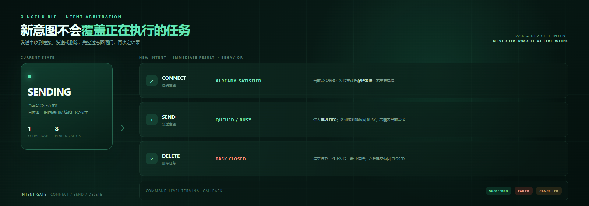
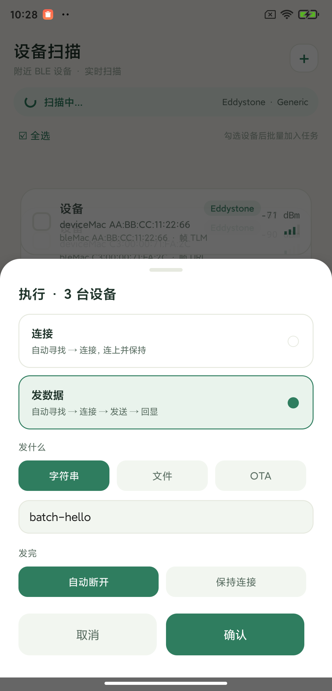
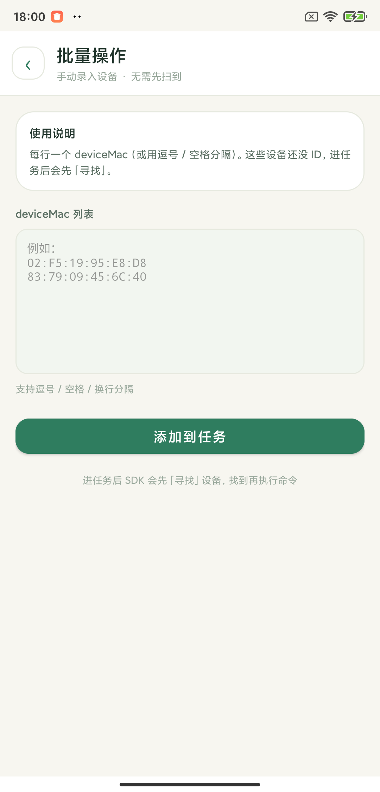

# Qingzhu-BLE

[](https://developer.android.com)
[](https://gradle.org)
[](https://github.com/qingzhu-ai-public/qingzhu-ble-android)

> 一个能跑的 BLE Demo 不难：`Scan → Connect → Discover Services → Write → Notify`，几分钟就能让一台设备回一句话。
>
> **但如果换成几十台设备、几种协议、页面被反复点开、设备会休眠换地址、蓝牙栈时不时甩出 133/8/19 呢？**

Qingzhu-BLE 是一个**以任务为中心**的 Android BLE SDK：一台设备就是一个任务，丢进池里，连接、发送、重试、收尾全托管。对外提供扫描、自动寻人、连接、发送、命令排队、取消与删除、超时重试和协议插件化；对内处理串行建连、传输窗口、地址轮换、心跳、断连恢复和迟到回调。接入自己的设备，只需注册一个协议插件。

> **你只需要把现有产品的设备协议告诉 AI，让它帮你接入 `ProtocolPlugin`。** 扫描、连接、服务发现、GATT 收发、超时、重试、命令队列、多设备调度和异常恢复，底层已经处理好，不用为每个产品重写一套 BLE 状态机。给 AI 协议文档、帧格式、抓包或示例数据即可，不要让它猜协议。提示词见 [2.0 用 AI 接入](#20-用-ai-接入推荐先做)。

---

## 先选你的角色

这份 README 按四类读者组织，点开你关心的那一段就行。

| 你是 | 想回答的问题 | 去哪 |
|---|---|---|
| 决策者 / 评估者 | 这套 SDK 能用在哪些产品？和常见做法比强在哪？值不值得用？ | [01 产品价值](#01-给决策者能马上用在哪为什么值得用) |
| SDK 使用者 | 怎么接？从初始化到每个场景要写几行代码？ | [02 API 文档](#02-给-sdk-使用者从初始化到每个场景) |
| SDK 开发者 | 自家公司的设备协议怎么对接？ | [03 协议对接](#03-给-sdk-开发者接一个自己的协议) |
| 架构研究者 | 内核怎么分层？底层机制与设计取舍是什么？边界在哪？ | [04 架构设计](#04-给架构研究者总体架构与底层机制) |

**快速入口**

[在线文档](https://qingzhu-ai-public.github.io/qingzhu-ble-android/)（[接入指南](https://qingzhu-ai-public.github.io/qingzhu-ble-android/index.html?view=guide) · [架构全景](https://qingzhu-ai-public.github.io/qingzhu-ble-android/index.html?view=arch)） · [下载试玩](#a1-下载试玩) · [全栈蓝牙课堂](https://qingzhu-ai-public.github.io/qingzhu-blue/academy/index.html) · 实现思路文章《[AI 时代，如何做一个生产级 Android BLE SDK ？](https://qingzhu-ai-public.github.io/qingzhu-blue/#android/experience/from-runnable-to-production)》 · [Fullstack 教学基线源码](reference/fullstack)

## 目录

- [01 给决策者：能马上用在哪，为什么值得用](#01-给决策者能马上用在哪为什么值得用)
- [02 给 SDK 使用者：从初始化到每个场景](#02-给-sdk-使用者从初始化到每个场景)
- [03 给 SDK 开发者：接一个自己的协议](#03-给-sdk-开发者接一个自己的协议)
- [04 给架构研究者：总体架构与底层机制](#04-给架构研究者总体架构与底层机制)
- [附录 A：工程信息](#附录-a工程信息)
  - [A1 下载试玩](#a1-下载试玩)
  - [A2 构建与测试](#a2-构建与测试)
  - [A3 参考工程](#a3-参考工程)
  - [A4 Screenshot](#a4-screenshot)
  - [A5 常见问题](#a5-常见问题)
  - [A6 版本 / License / Contribute](#a6-版本--license--contribute)

---

## 01 给决策者：能马上用在哪，为什么值得用

### 先说问题，再给答案

写一个能跑的 BLE Demo 只证明了一件事：**一台手机、一台设备、一次理想操作，能跑通。**

真实项目不是这样。设备会同时连很多台，页面会被反复点，设备会休眠、会换地址，任务会中途取消，蓝牙栈会甩出 133/8/19，不同机型脾气不一样，跑久了还会泄漏资源。大型项目还有第二层麻烦：**多套设备 SDK 并存**——每套都自带扫描、连接、重试、队列和错误模型，都以为自己独占蓝牙资源，结果就是重复实现、状态打架、修复分散。

这套设计有一个前提，一句话就能说清：

> **BLE 资源在一个进程里是共享的，必须有明确的所有者；否则任何调度策略都无法生效。**

所以 Qingzhu-BLE 不是再写一个薄封装，而是把这两层问题收进同一套架构。

### 能马上用在哪些产品

| 产品类型 | 典型用法 | 用上的能力 |
|---|---|---|
| 智能家居 | 灯、门锁、传感器同时在线，随时控制与查状态 | 多连接并发 · 心跳探活 · 单设备串行 |
| 设备管理 / 批量运维 | 一串设备批量配置、批量 OTA，失败清单可重试 | 每设备队列 · stage/error · 进度快照 |
| 蓝牙网关 | 云端常连，收到指令后转发控制周边 BLE 设备 | 永久连接 · 自动重连 · 指令队列 |
| 零售 / 电子价签 | 批量改价、多面刷图、一机一密 | 多附件 · 分包传输 · 进度回调 |
| 工业 / 资产监测 | 轮询采集、换址仍认得、掉线能发现 | stableId · 地址新鲜度 · 断连恢复 |
| 穿戴 / 健康 | 单设备长连同步，页面反复进出不断错连接 | keepConnected · 恰好一次 · 任务替换 |

这些产品形态差别很大，但拆到底都是「**设备管理 + 指令编排 + 结果回调**」——正好是内核做完的部分。

### 和常见做法比，差在哪

| 常见做法 / 薄封装 SDK | Qingzhu-BLE |
|---|---|
| 每个 App 自己写扫描 → 连接 → 分包 → 超时 → 重试的状态机 | 任务池托管全流程，业务只用一条 `QCommand` 表达意图 |
| 多台同时建连，Android BLE 栈互相撞车（133 / 排队 / 越连越慢） | 建连串行闸门 + 并发容量，按设备建议值给起点 |
| 设备换地址就重复建任务、列表里一行变两行 | stableId 全链路去重 + 扫描缓存地址新鲜度，换址自动跟随 |
| 失败只知道「失败了」，排查靠猜 | TaskState / TaskStage / TaskOutcome / 进度快照，知道卡在哪一步 |
| 每接一种新设备，就往核心加 if/else | 协议插件化：公共能力在 core，设备差异上浮为插件 |
| 页面反复进出，旧页面迟到的清理把新连接断掉 | 新任务替换旧任务、旧意图作废、迟到回调失效 |
| 超时、重试、心跳、保活各写一套，参数散落各处 | 统一配置中心，分层超时与可声明心跳节奏 |

**三个价值点**：缩短接入周期（新设备从重写状态机变成写一个插件）、降低线上事故（真实项目里踩过的坑统一收口）、跨产品线复用（一个 BLE 所有者、多种协议）。

### 「马上用上」具体是哪几步

1. Gradle 引入 `qingzhu-company-sdk`（它以 `api` 方式传递 `qingzhu-core` 与两个示例协议）；
2. 声明蓝牙 / 定位权限，Android 12+ 动态申请 `BLUETOOTH_SCAN`、`BLUETOOTH_CONNECT`；
3. `init → startScan → createTask → task.send(...)`，四步发出第一条指令；
4. 要接自家设备：实现一个 `ProtocolPlugin` 注册进去，内核与业务代码都不用改。

也可以先装 [试玩 APK](#a1-下载试玩)：主端 + 两个从端模拟器，两台手机就能跑通完整链路。

### 配套基础课程

[全栈蓝牙课堂](https://qingzhu-ai-public.github.io/qingzhu-blue/academy/index.html)：从 BLE 基础、广播与 GATT，到 Android 实战与工程化的一套系统课程。团队新人可以先补基础，再来看这套 SDK 的架构取舍。

### 诚实边界

> 当前仍是**源码预览版**：核心状态机、任务池、连接池与两个示例协议已可构建、可测试，试玩 App 可直接运行；长期稳定性、机型兼容性和多插件冲突治理仍在继续验证。正式宿主 AAR 由内部工程打包，公开仓库以源码模块方式接入。已知边界见 [4.5](#45-已知边界)。

---

## 02 给 SDK 使用者：从初始化到每个场景

**心智模型只有一句：万物皆任务。** 任务 = 一台设备 + 一条可选命令；内核负责寻人、排队、连接、发送、失败重试与收尾。

### 2.0 用 AI 接入（推荐先做）

这是源码预览仓库，推荐先把工程拉到本地，再让 AI 读代码和 README，最后接入你的 App。

```bash
git clone https://github.com/qingzhu-ai-public/qingzhu-ble-android.git
cd qingzhu-ble-android
```

复制到 Codex / Claude Code / Cursor / CodeBuddy 等工具：

```text
你是 Android BLE 工程师。请先不要修改代码，只阅读并理解这个仓库：
https://github.com/qingzhu-ai-public/qingzhu-ble-android

请按顺序阅读：
1. README 的「先说问题，再给答案」「架构设计」「API 清单」「接入文档」
2. qingzhu-company-sdk/src/main/java/com/qingzhu/sdk/QingzhuSdk.java
3. qingzhu-core/src/main/java/com/qingzhu/ble/sdk/core/api/QTask.java
4. qingzhu-core/src/main/java/com/qingzhu/ble/sdk/core/api/QCommand.java
5. qingzhu-core/src/main/java/com/qingzhu/ble/sdk/core/protocol/ProtocolPlugin.java
6. qingzhu-core/src/main/java/com/qingzhu/ble/sdk/core/QSdk.java

读完后用不超过 800 字回答：
- 这个 SDK 解决什么问题
- core、门面、协议插件分别负责什么
- 扫描、提交任务、连接、发送的调用顺序
- 接入一个自有设备协议时必须实现哪些方法
- 哪些能力已经实现，哪些仍是边界

不要先写代码，不要改公开仓库，先输出理解结果。
```

AI 阅读顺序：

```text
README → QingzhuSdk（门面 API）→ QTask / QCommand（任务和命令）
       → ProtocolPlugin（协议扩展）→ QSdk（扫描、任务创建、观察者）
       → QTaskPool（命令排队、状态机、重试）
```

### 2.1 接入前提示

1. 设备只有一种类型：实现一个 `ProtocolPlugin`，初始化后注册即可。
2. 设备有多种类型：每种设备一个插件，扫描结果通过 `device.getProtocolType()` 区分。
3. 只给 MAC 也能创建任务：SDK 会先扫描寻人，找到后自动连接和发送。
4. 同一台设备同一时刻只有一个有效任务：`createTask` 会替换已有任务，需要复用时用 `getTask`。

### 2.2 五步发第一条指令

**1. 添加依赖**

```groovy
// settings.gradle
include ':qingzhu-core'
include ':qingzhu-company-sdk'
include ':qingzhu-protocol-generic'
include ':qingzhu-protocol-eddystone'
```

```groovy
// app/build.gradle
dependencies {
    implementation project(':qingzhu-company-sdk')
}
```

> 当前公开仓库只提供源码模块接入和试玩 APK；宿主 AAR 由内部工程打包，不在公开仓库发布。`qingzhu-company-sdk` 是唯一源码门面。

**2. 配置权限**

```xml
<uses-permission android:name="android.permission.BLUETOOTH_SCAN" />
<uses-permission android:name="android.permission.BLUETOOTH_CONNECT" />
<uses-permission android:name="android.permission.BLUETOOTH" android:maxSdkVersion="30" />
<uses-permission android:name="android.permission.BLUETOOTH_ADMIN" android:maxSdkVersion="30" />
<uses-permission android:name="android.permission.ACCESS_FINE_LOCATION" />
<uses-permission android:name="android.permission.ACCESS_COARSE_LOCATION" />
<uses-permission android:name="android.permission.WAKE_LOCK" />
```

Android 12 及以上动态申请 `BLUETOOTH_SCAN` 和 `BLUETOOTH_CONNECT`；Android 11 及以下通常需要定位权限并打开系统定位。

**3. 初始化**（幂等，注入内核并注册两个开源示例协议）

```java
public class App extends Application {
    @Override
    public void onCreate() {
        super.onCreate();
        QingzhuSdk.init(this);
    }
}
```

**4. 扫描**（按 stableId 去重，每秒批量回调）

```java
QingzhuSdk.startScan(new QSdk.ScanListener() {
    @Override
    public void onDevices(List<QDevice> devices) {
        for (QDevice device : devices) {
            String name = device.getName();
            String mac = device.getMac();
            String stableId = device.getStableId();
            int rssi = device.getRssi();
            String protocol = device.getProtocolType().getId();
        }
    }

    @Override
    public void onScanFailed(int errorCode, String message) {
        // 权限、蓝牙关闭或系统扫描失败
    }

    @Override
    public void onScanStopped(List<QDevice> devices) {
        // 定时扫描结束时的最终快照
    }
});
```

列表去重请使用 `getStableId()`，不要只依赖 MAC。地址轮换设备只有稳定身份不变。

扫描设置（过滤只作用于 UI 回调，任务池仍能看到完整广播，不影响自动寻人和重寻址）：

```java
QingzhuSdk.startScan(
        ScanOptions.builder()
                .setTimeoutMs(30_000)       // 30 秒后自动停止；0 = 持续扫描
                .setMinRssi(-80)             // 忽略更弱的设备
                .setNamePrefix("ESL")        // 名称前缀，大小写不敏感
                .addProtocol("generic")      // 只显示指定协议
                .addStableId("A1B2C3D4E5F6") // 只显示指定稳定身份
                .build(),
        listener
);

QingzhuSdk.setScanStateListener(scanning -> {
    // true = 扫描中；false = 已停止
});
```

停止扫描：

```java
QingzhuSdk.stopScan();
```

任务层会自动开扫描，但**不会自动关扫描**：只给 MAC 发命令时，`send()` 会自动开扫描寻人，找到后连接、发送；默认 `ble.scanTimeoutSec = 0` 表示持续扫描不停止。这是为了保持设备发现与重寻址的效率，关闭时机交给业务——退出界面、登出、应用退到后台时调用 `stopScan()`。

> 注意：`stopScan()` 会直接停掉底层扫描，正在 `SEARCHING` 的任务不会重新拉起扫描，只能等 30 秒超时后重试。尽量在任务都结束或取消之后再关。

**5. 创建任务并发送**

```java
QTask task = QingzhuSdk.createTask(mac);
task.setConnectParams(params);           // 可选：连接参数属于任务

QCommand command = QCommand.builder()
        .send("{\"action\":\"echo\"}")
        .disconnectAfter()               // 短连接：发完自动断
        .build();

task.send(command, result -> {
    if (result.isSuccess()) {
        String echo = result.payload();   // 设备回显，可能为 null
    } else {
        TaskStage stage = result.stage();
        String error = result.error();
    }
});
```

三个任务入口：

```java
QTask task = QingzhuSdk.createTask(device);   // 已经拿到扫描设备
QTask task = QingzhuSdk.createTask(mac);      // 只知道 MAC
QTask existing = QingzhuSdk.getTask(mac);     // 只查询，没有则返回 null
QingzhuSdk.deleteTask(mac);                   // 删除，不存在则忽略
```

| | `createTask` | `getTask` |
|---|---|---|
| 该设备已有任务 | 先删除旧任务，再新建 | 返回已有任务 |
| 该设备没有任务 | 新建 | 返回 `null` |
| 旧任务的连接 | 被断开，旧任务之后的调用全部失败 | 不受影响 |

需要在多个页面共享同一台设备的任务时，用 `getTask`，没有再 `createTask`；只给 MAC 时，任务会先进入寻人状态，SDK 找到设备后自动连接，不需要业务自己先扫描再连接。

### 2.3 场景速查

同一个 `QCommand.builder()`，加减几个方法就是不同命令；连接参数单独放在任务上。

**连接并保持**

```java
task.connect(result -> {
    if (result.isSuccess()) {
        // 已连接并保持
    } else {
        // result.stage()、result.error()
    }
});
```

`task.connect(callback)` 等同于 `task.send(QCommand.builder().connect().build(), callback)`；断开但保留任务用 `task.disconnect()`。

**JSON + 单块字节 / 多附件（OTA、刷图）**

```java
QCommand.builder().send("{\"action\":\"ota\"}", firmwareBytes).build();

Map<String, Object> attachments = new HashMap<>();
attachments.put("partA", bytesA);
attachments.put("partB", bytesB);
QCommand.builder().send("{\"action\":\"write-parts\"}", attachments).build();
```

**发完是否断开**

```java
QCommand.builder().send(json).keepConnected().build();    // 发完保持连接
QCommand.builder().send(json).disconnectAfter().build();  // 发完必须断开
```

默认行为取决于任务当前是否带「保持连接」期望：任务经 `connect` 连接过则发完保持，否则发完断开。`disconnectAfter()` 优先于这个期望，适合「发完必须断开设备才生效」的设备。同时调用 `keepConnected()` 和 `disconnectAfter()` 会在 `build()` 时抛 `IllegalStateException`。

**长连接并允许意外断开后自动重连**

```java
task.send(QCommand.builder().connect().reconnect(policy).build(), callback);
```

`reconnect` 默认为 `ReconnectPolicy.OFF`，不是默认无限重连。

**单个设备配置 / 批量配置**

```java
QTask task = QingzhuSdk.createTask(mac);
task.setConnectParams(params);
task.send(configCommand, result -> {
    if (result.isSuccess()) {
        finish();
    } else if (result.stage() == TaskStage.CANCEL) {
        showCancelled();
    } else {
        showError(result.error());
    }
});
```

```java
AtomicInteger remaining = new AtomicInteger(macs.size());
AtomicInteger failed = new AtomicInteger();

for (String mac : macs) {
    QTask task = QingzhuSdk.createTask(mac);
    task.send(configCommand, result -> {
        if (!result.isSuccess()) {
            failed.incrementAndGet();
        }
        if (remaining.decrementAndGet() == 0) {
            showSummary(macs.size(), failed.get());   // 回调在主线程
        }
    });
}
```

批量就是对每台设备循环，每台一个任务，业务自己统计结果。注意 `createTask` 会替换该设备已有的任务；如果某台设备的任务正在其它页面使用，改用 `getTask(mac)` 复用，避免静默替换。

**全部 Builder 形式**

```java
QCommand.builder().connect().build();
QCommand.builder().send(json).build();
QCommand.builder().send(json, bytes).build();
QCommand.builder().send(json, attachments).build();
QCommand.builder().send(json).keepConnected().build();
QCommand.builder().send(json).disconnectAfter().build();
QCommand.builder().send(json).noAck().build();
QCommand.builder().connect().reconnect(policy).build();
```

连接参数通过 `task.setConnectParams(params)` 设置，对该任务之后的所有连接生效，由协议插件解释，内核只负责传递；连接参数不属于命令，不能放进 `QCommand`。核心只传递命令，不关心 `action` 的含义，具体含义由协议插件解析，新增指令不需要修改任务池 API。

> `noAck()` 目前只是命令上的标记，**还没有传给底层，暂不起作用**。

### 2.4 任务状态与结果

`task.send(command, callback)` 发送一条命令，结果经 `TaskCallback` 回调一次，回调在主线程，**包括被拒绝的情形也恰好回调一次**。

**观察所有任务**（不可变 `TaskSnapshot` 列表，注册后立即推送一次当前快照）：

```java
Subscription sub = QingzhuSdk.observeAll(this, snapshots -> {
    for (TaskSnapshot s : snapshots) {
        TaskState state = s.state();
        TaskOutcome outcome = s.outcome();
        int progress = s.progress();
        int sent = s.sentBytes();
        int total = s.totalBytes();
        String result = s.result();
        String error = s.error();
        int pending = s.pendingCount();
    }
});

sub.cancel();   // 提前取消；传入 owner 的订阅在 owner 回收后也会自动失效
```

只关心某一个任务：`Subscription sub = task.observe(this, snapshot -> { /* 状态变化 */ });`

`TaskState` 回答「现在在做什么」，`TaskOutcome / result / error` 回答「上一次结果是什么」。SDK 没有单独的 `FAILED` 状态；失败后任务回到 `READY` 或 `UNKNOWN`，失败类型和原因放在终态字段里。

| 状态 | 含义 |
|---|---|
| `UNKNOWN` | 只有 MAC，还没找到设备 |
| `READY` | 已找到设备，空闲、未连接 |
| `SEARCHING` | 占位任务正在扫描寻人 |
| `QUEUED` | 等连接窗口、传输窗口，或处在重试等待 |
| `CONNECTING` | 正在建立 GATT 连接 |
| `CONNECTED` | 已连接，空闲或保持连接 |
| `SENDING` | 正在发数据，看 `progress / sentBytes / totalBytes` |

**单条命令结果**

| `isSuccess()` | `stage()` | 含义 |
|---|---|---|
| `true` | - | 成功，`payload()` 是设备回显，可能为 null |
| `false` | `SEARCH` / `CONNECT` | 寻人或连接阶段失败，重试耗尽 |
| `false` | `SEND` | 已连接后发送或业务失败，重试耗尽 |
| `false` | `CANCEL` | 被 `cancel()` / `disconnect()` 取消，或前序命令失败导致取消 |
| `false` | `DELETE` | 任务被删除 |
| `false` | `BUSY` | 待办队列已满，命令没有被接受 |
| `false` | `CLOSED` | 任务已删除，不能再接收命令 |

**看任务快照时怎么判断成功失败**

| UI 语义 | 判断条件 |
|---|---|
| 正在执行 | `state` 为 `SEARCHING / QUEUED / CONNECTING / SENDING` |
| 有排队命令 | `pendingCount() > 0` |
| 成功 | `outcome == SUCCEEDED` 且 `error == null` |
| 连接阶段失败 | `outcome == CONNECT_FAILED` |
| 发送或业务失败 | `outcome == OPERATION_FAILED` |
| 取消或删除 | `outcome == CANCELLED` |

> 关键：`result != null` 不等于成功。成功失败的权威字段是 `TaskOutcome`，`state` 只说明当前阶段。

### 2.5 命令排队、取消与删除

同一台设备同一时刻只发一条命令，后续命令进入该任务的待办队列，不会覆盖当前命令。

| 当前状态 | 新命令 | 行为 |
|---|---|---|
| 已连接 | `connect` | 立即回调成功，不重复建连 |
| 正在发送 | `connect` | 立即回调成功，发送完成后保持连接 |
| 正在连接 | `connect` | 合并，连接结果出来时一并回调 |
| 正在发送 | `send` | 进入待办队列 |
| 待办已满 | `send` | 回调 `TaskStage.BUSY` |
| 任务已删除 | 任意 | 回调 `TaskStage.CLOSED` |

每台设备默认最多排队 10,000 条；队列的 `offer / poll / size / clear` 由底层同步保护，容量判断和入队是原子操作，队列满时不会被静默丢弃。

```java
QingzhuSdk.setMaxPendingIntents(10_000); // 默认值
QingzhuSdk.setMaxPendingIntents(0);      // 0 = 忙碌时直接失败，不排队
```



取消 / 断开 / 删除三种语义严格区分：

```java
task.cancel();      // 取消当前操作，回到操作开始前的链路状态，任务保留
task.disconnect();  // 断开连接，任务保留
task.delete();      // 取消当前操作、断开连接，并从任务池移除
```

| | `cancel()` | `disconnect()` | `delete()` |
|---|---|---|---|
| 停止当前操作 | 是 | 是 | 是 |
| 之后的链路 | 回到操作开始前的状态 | 断开 | 断开 |
| 任务留在池里 | 是 | 是 | 否 |
| 命令回调的 `stage` | `CANCEL` | `CANCEL` | `DELETE` |
| 之后再调用 | 任务可继续使用 | 任务可继续使用 | 所有调用返回失败 |

`cancel()` 的回退规则：操作开始前已连接且正在发送，只中止发送、保持连接；其余情形（寻人、排队、建连、重试等待，或操作开始前未连接）都断开回到未连接。删除任务也可以不持有任务句柄：`QingzhuSdk.deleteTask(mac)`。

### 2.6 多设备调度

```java
QingzhuSdk.setMaxConnections(0);        // 0 = 按设备建议值，1-N = 手动固定
QingzhuSdk.setMaxTransfers(1);          // 1 = 串行传输
QingzhuSdk.setMaxRetries(3);            // 连接/发送/寻人失败重试次数
QingzhuSdk.setMaxPendingIntents(10_000); // 每设备待执行命令数（默认 10,000）
QingzhuSdk.setConnectCallbackTimeoutMs(20_000); // GATT 连接回调兜底

int currentCapacity = QingzhuSdk.getConcurrency();
```

普通机型建议从 `setMaxConnections(0)` + `setMaxTransfers(1)` 开始；目标机型验证稳定后再提高传输并发。

> `setMaxConnections(0)` 只在初始化时取一次建议值，不会根据运行结果自动调整。需要更高或更低的并发，请手动指定。


**网关场景：云端指令 → 多设备转发**

适用于 App/门店盒子常驻运行，云端通过 MQTT、HTTP 或 WebSocket 下发指令，本地再转发给多台设备。

```text
云端指令队列
    ↓ MQTT / HTTP
App 网关调度层
    ↓ QingzhuSdk.getTask / createTask
每台设备一个 QTask（任务内 FIFO）
    ↓
BLE 连接 → 发送 → 回显 → 回执云端
```

```java
public void dispatch(CloudCommand cmd) {
    // 复用已有任务；createTask 会先删除旧任务，直接调用会清空该设备排队中的指令
    QTask task = QingzhuSdk.getTask(cmd.mac);
    if (task == null) {
        task = QingzhuSdk.createTask(cmd.mac);
    }

    QCommand command = QCommand.builder()
            .send(cmd.payload)
            .keepConnected()   // 常驻网关可保持连接
            .build();

    task.send(command, result -> {
        if (result.isSuccess()) {
            cloud.ack(cmd.id, result.payload());   // payload 是设备回显，可能为 null
        } else if (result.stage() == TaskStage.BUSY) {
            cloud.requeue(cmd.id);                 // 待办队列满，未被接受
        } else {
            cloud.fail(cmd.id, result.stage(), result.error());
        }
    });
}
```

| 项目 | 说明 |
|---|---|
| 排队粒度 | 每台设备一个 `QTask`，同一设备 FIFO、同一时刻只发一条 |
| 默认上限 | 每台设备 10,000 条待发送命令，可用 `setMaxPendingIntents` 调整 |
| 跨设备并发 | 由 `setMaxConnections` / `setMaxTransfers` 控制，不同设备可并行 |
| 队列满 | `send` 回调 `TaskStage.BUSY`，不会覆盖或丢弃已接受的命令 |
| 回调线程 | `TaskCallback` 在主线程回调，可直接更新 UI 或发送云端回执 |
| 进程重启 | 队列在内存中，重启后丢失；云端需保留未确认指令并重新投递 |

云端重试时建议携带业务 `cmd.id` 做幂等去重；同一台设备的指令不要并发调用 `createTask` 替换任务。

### 2.7 API 清单

| 类型 | 说明 |
|---|---|
| [QingzhuSdk](qingzhu-company-sdk/src/main/java/com/qingzhu/sdk/QingzhuSdk.java) | 开源门面：初始化、扫描、任务创建/查询/删除、全局任务观察、调度配置、协议注册 |
| [QDevice](qingzhu-core/src/main/java/com/qingzhu/ble/sdk/core/device/QDevice.java) | 扫描到的设备模型：MAC、名称、RSSI、稳定身份、协议类型、metadata |
| [QCommand](qingzhu-core/src/main/java/com/qingzhu/ble/sdk/core/api/QCommand.java) | 连接/发送命令：JSON、字节、多附件、保持连接、发完断开、重连策略 |
| [QTask](qingzhu-core/src/main/java/com/qingzhu/ble/sdk/core/api/QTask.java) | 任务句柄：发送、连接、断开、取消、删除、状态观察、连接参数设置 |
| [TaskResult](qingzhu-core/src/main/java/com/qingzhu/ble/sdk/core/api/TaskResult.java) / [TaskStage](qingzhu-core/src/main/java/com/qingzhu/ble/sdk/core/api/TaskStage.java) | 单条命令的最终结果，以及失败所处阶段 |
| [TaskSnapshot](qingzhu-core/src/main/java/com/qingzhu/ble/sdk/core/api/TaskSnapshot.java) | 任务的不可变快照，供 `observeAll` / `observe` 回调 |
| [TaskState](qingzhu-core/src/main/java/com/qingzhu/ble/sdk/core/api/TaskState.java) | 任务状态 |
| [Subscription](qingzhu-core/src/main/java/com/qingzhu/ble/sdk/core/api/Subscription.java) | 订阅句柄，可提前取消 |
| [ProtocolPlugin](qingzhu-core/src/main/java/com/qingzhu/ble/sdk/core/protocol/ProtocolPlugin.java) | 协议插件接口，新设备类型通过它接入 |

> **这一节的落点**：以前要在 Activity 里维护连接状态、定时器、重试计数、分包队列和一堆回调分支；现在业务只写「给谁、发什么」，**状态、顺序、资源由任务池唯一拥有**。

---

## 03 给 SDK 开发者：接一个自己的协议

内核只认识 `ProtocolPlugin` 这一种「协议形状」。把自家设备的识别方式、连接准备、收发格式告诉内核，扫描、连接、调度、重试、错误模型全部复用，不需要改内核或门面。

### 插件要实现什么

| 能力 | 必需 | 作用 |
|---|---|---|
| `protocolType()` / `recognizer()` | 必需 | 协议唯一 id 与广播识别器；扫描按注册顺序问协议，第一个认领者解析 |
| `identityKey()` | 建议 | 声明身份字段，stableId 由内核统一分配，换 MAC 仍认得同一台 |
| `beforeConnect()` | 可选 | 连接前钩子：重寻址、取密钥、握手；完成后调 `onReady` |
| `onGattReady()` | 可选 | 业务准备：找特征、协商 MTU、使能通知、认证 |
| `connectSteps()` | 可选 | 自定义连接步骤；返回 null 走内核默认流程 |
| `heartbeatCommand()` / `heartbeatConfig()` | 可选 | 声明心跳指令与协议级节奏；返回 null 即零开销不做心跳 |
| `scanConfig()` / `scanManufacturerIds()` | 可选 | 系统扫描参数与硬件过滤下沉；全部协议都声明厂商 ID 时才下沉 |
| `install()` | 建议 | 装配钩子：把自己的 `ActionHandler` 注册进路由 |
| `configurableParams()` | 可选 | 只声明可配项，不赋值；取值权留给上层 SDK |

### 对接流程

1. 写 `Recognizer`：从广播里认出自家设备，并解析出身份 metadata；
2. 写 `ActionHandler`：把业务 JSON + 字节附件翻译成设备帧，解析应答并返回 `JsonResponse`；
3. 按设备需要补 `beforeConnect` / `onGattReady`（认证、MTU、通知）；
4. 实现 `ProtocolPlugin`，在 `install()` 里注册 Handler；
5. 初始化后注册，之后业务代码始终不变。

```java
QingzhuSdk.init(context);
QingzhuSdk.registerProtocol(new MyProtocolPlugin());

// 业务代码始终不变：JSON 进、JSON 出，协议差异关在插件里
QTask task = QingzhuSdk.createTask(mac);
task.send(QCommand.builder().send("{\"action\":\"setConfig\"}").build(), r -> handle(r));
```

注册是幂等的，可用 `QingzhuSdk.getProtocols()` 确认。公开仓库以源码模块编译期依赖 + 运行时 `ProtocolRegistry.register` 装配；插件声明可配项但不赋值，取值权留给上层。

### 路由与失败语义

- **JSON → JSON**：发送链路经 `TaskScheduler` 按 mac 串行进入 `ActionRouter`，按 protocolId 找到对应 `ActionHandler`；结果统一以 `JsonResponse` 返回。core 不认识业务语义，也不预设消息格式。
- **不静默成功**：已连上但 Handler 未注册，返回 `PROTOCOL_NOT_FOUND = 1201`；整个协议插件不在包里，广播无人认领，最终以 30 秒寻人超时失败。两种都带 stage / error，可直接定位。

两个现成参考实现：[GenericProtocolPlugin](qingzhu-protocol-generic/src/main/java/com/qingzhu/protocol/generic/GenericProtocolPlugin.java)（Service Data 0xFFE0，echo / OTA / 心跳）、[EddystoneProtocolPlugin](qingzhu-protocol-eddystone/src/main/java/com/qingzhu/protocol/eddystone/EddystoneProtocolPlugin.java)（0xFEAA UID / URL / TLM）。

> **这一节的落点**：新增设备类型 = 新增一个插件，内核、门面、业务调用都不动。

---

## 04 给架构研究者：总体架构与底层机制

这一节只讲设计，不贴实现代码。核心前提：**一个 BLE 所有者，多种协议**。

### 4.1 总体分层


| 层 | 职责 |
|---|---|
| 门面层 `QingzhuSdk / QSdk` | 唯一对外入口，直接暴露内核类型；负责初始化、协议装配、扫描订阅、任务创建与调度旋钮 |
| 内核层 `QTaskPool · ConnectionPool · ScanEngine · TaskScheduler` | 协议无关的状态与资源所有者：任务池管「一设备一任务 + 意图队列」，连接池管「同时连几台 + 建连闸门」，扫描引擎管「识别 → 去重 → 缓存」，调度器保证同一 mac 串行 |
| 平台层 `BleAdapter · AndroidBleAdapter · AndroidBleScanner · AndroidGattClient` | 把内核语义翻译成 Android 能力；平台接口只约定「扫描 / 连接 / 发数据」，唯一触碰 `BluetoothGatt` 的地方在平台实现里 |
| 协议插件层 `ProtocolPlugin · ProtocolRegistry · ActionRouter` | 设备差异上浮：识别广播、连接前握手、MTU/通知、心跳、业务帧翻译；内核按 protocolId 路由 |

### 4.2 设计理念

| 设计理念 | 解决的问题 |
|---|---|
| **任务式模型** | 业务只表达「这台设备要做什么」，SDK 管扫描、寻人、排队、连接、发送、取消、重试和收尾 |
| **统一资源调度** | 一个内核拥有扫描、建连、连接容量和传输窗口；串行建连、多设备调度和迟到回调治理有唯一落脚点 |
| **异常治理** | 处理地址轮换、扫描假死、心跳失活、断连恢复、超时重试、取消后的旧回调污染 |
| **协议插件化** | 公共能力下沉到 core，设备差异上浮为协议插件；新增协议不改内核 |
| **可诊断性** | 任务自带状态、进度、结果、错误，每条命令都有最终结果和失败阶段 |

### 4.3 六个核心机制

1. **任务池 · 一设备一任务**：任务 = 设备 + 可选命令；命令进有界 FIFO 意图队列，状态在 `UNKNOWN / READY` 与 `SEARCHING → QUEUED → CONNECTING → CONNECTED → SENDING` 之间流转。所有终态收口到一处，保证每条命令恰好回调一次。
2. **连接池 · 串行进门、池化管理**：建连走全局串行闸门，避免 Android BLE 栈同时建连互相撞车；连上之后各任务并行推进。容量起点按设备建议值给出，支持手动接管。
3. **身份与缓存 · stableId 全链路去重**：协议声明身份字段，扫描引擎生成稳定 id；扫描缓存按它组织、跨换址只留最新地址。连接前以「地址新鲜度」为唯一闸门，换址自动跟随，不重复建任务。
4. **扫描引擎 · 识别、去重、自愈**：逐条识别并实时更新缓存，按秒批量上报；看门狗应对零广播、启动限流避开系统风控，蓝牙开关与亮屏事件自动恢复扫描，离开范围只置灰不删快照。
5. **超时与重试 · 分层不打架**：连接回调兜底、连接流程步骤超时、单条命令应答超时、大块传输停滞检测各管一层；优先级为单条命令 > 连接级参数 > 全局配置 > 默认值。失败带 stage / error，重试间隔与退避统一。
6. **生命周期治理 · 迟到回调与资源回收**：取消、断开、删除三种语义严格区分；删除任务会作废排队意图、递增发送代次让迟到回调失效，并回收仍占用的链路。心跳探活与永久重连复用同一套收尾流程。

### 4.4 关键设计取舍

| 取舍 | 为什么这样设计 |
|---|---|
| 连接参数属于任务，不属于命令 | 「这台设备怎么连」是设备级信息；命令只描述「这次干什么」。core 只承载、不翻译，由协议在连接前钩子读取 |
| 扫描常开，不因建连暂停 | 扫描缓存要求逐条实时更新，连接池的重连轮询依赖新鲜地址。射频竞争用「建连串行闸门 + 传输窗口」治理，而不是停扫描 |
| 建连串行、传输并行 | 同时建连会让 BLE 栈不稳定、批量反而变慢；连上之后各设备各发各的，互不等待 |
| 命令结果恰好回调一次 | 成功、失败、取消、删除、超时、拒收都从同一个终态收口，用原子完成标记挡住重复回调 |
| 协议按运行时注册 | 编译期源码模块依赖 + 运行时 `ProtocolRegistry.register` 装配；插件声明可配项但不赋值 |
| 大数据按「停滞」判超时 | 刷图 / OTA 数据量差异极大，按总时长容易误杀；有进展就续命，停滞才判失败，并配合 WakeLock 与写入窗口保序 |
| 可观测优先 | 任务自带状态、进度、已发/总字节、结果与失败阶段；配置中心可列出全部可配项 |

### 4.5 已知边界

- **没有设备主动上报通路**：`QTask` 没有 `listen`，设备主动推送的数据暂时无法通过任务接收。
- **扫描不会自动停止**：任务 `send` 可自动开扫描寻人，但任务层不负责关；默认持续扫描，业务需在退出界面、登出等时机主动 `stopScan()`。
- **没有自动并发学习**：`setMaxConnections(0)` 只在初始化时取一次建议值，不会根据运行结果自动调整。
- 服务发现返回 0 个服务时，当前仍被当成成功继续往下走；设备被短时间反复连断后可能进入异常，表现为连接后被设备主动断开（状态码 19）。
- 快速反复进出同一设备时，内核保证不会互相堵死，但不限制连接频率。
- 只有 Android 实现，`BleAdapter` 是预留的平台抽象。
- `ConnectionPool` 的真实时序（建连闸门、释放与复位）没有自动化测试，只能靠真机验证。

> **这一节的落点**：复杂度没有消失，而是被收进唯一拥有 BLE 资源的内核里；业务与协议各自只负责自己该知道的那部分。

---

## 附录 A：工程信息

### A1 下载试玩

| 角色 | 文件 | 说明 |
|---|---|---|
| 主端 | [qingzhu-demo-main-v1.0-debug.apk](downloads/qingzhu-demo-main-v1.0-debug.apk) | 扫描、添加任务、连接、发送、命令排队、调度配置 |
| 从端 | [qingzhu-demo-sim-generic-v1.0-debug.apk](downloads/qingzhu-demo-sim-generic-v1.0-debug.apk) | Generic 可编程外设，任意广播 + echo GATT |
| 从端 | [qingzhu-demo-sim-eddystone-v1.0-debug.apk](downloads/qingzhu-demo-sim-eddystone-v1.0-debug.apk) | Eddystone Beacon + 可连接 GATT 外设 |
| 校验 | [SHA256SUMS.txt](downloads/SHA256SUMS.txt) | 4 个 APK 的 SHA256 |
| 教学实战 | [bthome-thermometer-v1.0-debug.apk](downloads/bthome-thermometer-v1.0-debug.apk) | BTHome 温湿度计，一个 App 内含主端 + 从端，Android 8.0+，源码见 [samples/bthome-thermometer](samples/bthome-thermometer) |

前三个 APK 是 Debug 签名，Android 7.0+。

```bash
adb install -r downloads/qingzhu-demo-main-v1.0-debug.apk
adb install -r downloads/qingzhu-demo-sim-generic-v1.0-debug.apk
adb install -r downloads/qingzhu-demo-sim-eddystone-v1.0-debug.apk
```

试玩方式：主端装手机 A；手机 B 装 Generic 或 Eddystone 从端（两个都装也可以）；从端开启广播；主端扫描、连接、发送。试玩包只装配 Generic 和 Eddystone 两个开源协议，不包含私有设备协议。

**试玩 App 源码**

| 角色 | 源码模块 |
|---|---|
| 主端 | [`qingzhu-demo-main`](qingzhu-demo-main) |
| Generic 从端 | [`qingzhu-demo-sim-generic`](qingzhu-demo-sim-generic) |
| Eddystone 从端 | [`qingzhu-demo-sim-eddystone`](qingzhu-demo-sim-eddystone) |

从端 App 不依赖 SDK，完全用 Android BLE API 模拟真实外设。

### A2 构建与测试

环境：JDK 17+、Gradle 8.13、compileSdk 35、minSdk 24。

```bash
./gradlew \
  :qingzhu-demo-main:assembleDebug \
  :qingzhu-demo-sim-generic:assembleDebug \
  :qingzhu-demo-sim-eddystone:assembleDebug
```

APK 产物：

```text
qingzhu-demo-main/build/outputs/apk/debug/qingzhu-demo-main-debug.apk
qingzhu-demo-sim-generic/build/outputs/apk/debug/qingzhu-demo-sim-generic-debug.apk
qingzhu-demo-sim-eddystone/build/outputs/apk/debug/qingzhu-demo-sim-eddystone-debug.apk
```

单元测试：

```bash
./gradlew :qingzhu-core:testDebugUnitTest
```

覆盖 `createTask` 替换已有任务、`getTask` 只查询、`deleteTask`、连接幂等、发送成功回调、发完断开、`cancel` / `disconnect` / `delete` 的状态回退、命令排队、`observeAll` 取消订阅，以及被替换旧任务的迟到连接回调不会断开新任务共享的链路。

### A3 参考工程

**Fullstack 教学基线源码**：[`reference/fullstack`](reference/fullstack)（独立参考工程，不参与主 SDK 构建）。

```text
reference/fullstack/
├── fullstack-ble-sdk/             # 教学级 BLE SDK
├── fullstack-ble-demo/            # 主端 Demo
├── fullstack-ble-peripheral-sim/  # 从端模拟器
├── settings.gradle                # 独立 Gradle 工程
├── build.gradle
├── gradle.properties
└── README.md
```

它是独立 Gradle 工程，不加入主 `settings.gradle`，不会影响青竹 SDK 构建。用于对照「AI 生成的教学级 SDK」和「任务式生产架构」的差异。

```bash
./gradlew -p reference/fullstack :fullstack-ble-sdk:testDebugUnitTest
./gradlew -p reference/fullstack :fullstack-ble-demo:assembleDebug
./gradlew -p reference/fullstack :fullstack-ble-peripheral-sim:assembleDebug
```

更多说明见 [reference/fullstack/README.md](reference/fullstack/README.md)。

**BTHome 示例工程**：`samples/bthome-thermometer/` 是青竹蓝牙学堂 Android 第十四课的配套 App：不依赖任何 BLE SDK，只用 Android 原生 API 把一个真实协议从规范做到能跑。

- **协议层**：BTHome v2 的解析和编码，22 个单元测试（含官方样例、符号扩展、31 字节预算）。
- **主端**：按 0xFCD2 过滤扫描、按地址合并、10 秒无广播标离线、`onScanFailed` 退避重试。
- **从端**：模拟温湿度源 → 编码 → Legacy 广播，读数变化用 `setAdvertisingData` 热更新，设备名放扫描响应。
- **连接路线**（自定义教学服务，不属于 BTHome 标准）：`connectGatt → discoverServices → 写 CCCD 订阅通知 → 写入指令`。

```bash
./gradlew -p samples/bthome-thermometer :app:testDebugUnitTest
./gradlew -p samples/bthome-thermometer :app:assembleDebug
```

规范：<https://bthome.io/format>。玩法与验收清单见 [samples/bthome-thermometer/README.md](samples/bthome-thermometer/README.md)。

### A4 Screenshot

**主端 App**

| 扫描与协议识别 | 任务队列 | SDK 配置 |
|---|---|---|
|  |  |  |

| 命令面板 | 批量添加（只填 MAC） |
|---|---|
|  |  |

**从端模拟器**

| Generic 从端 | Eddystone 从端 |
|---|---|
|  |  |

> 所有图片来自本仓库提供的试玩 App 和模拟器。

### A5 常见问题

**扫描不到设备？** 检查蓝牙是否开启、运行时权限是否授予；Android 11 及以下还需要打开系统定位。

**为什么连接会慢？** 部分低功耗设备广播间隔长，系统 `connectGatt` 可能十几秒才回调。SDK 默认等待 20 秒，并在失败后等待新鲜广播再重试。

**为什么返回 BUSY？** 该设备已有发送任务，且待办队列达到上限。可以调大 `setMaxPendingIntents`，或在业务侧等待当前任务完成。

**为什么任务没有 FAILED 状态？** 失败后会回到 `READY` / `UNKNOWN`，具体错误写入 `getError()`；每条命令的最终结果通过 `TaskResult` 回调，失败阶段见 `TaskStage`。

更多问题请查看 [文档站](https://qingzhu-ai-public.github.io/qingzhu-blue/)。

### A6 版本 / License / Contribute

| 版本 | 日期 | 说明 |
|---|---|---|
| `v1.0.0-preview` | 2026-11-17 | 首个公开源码预览；任务内核、意图队列、Generic / Eddystone 协议、试玩 APK |
| `v1.0.0-preview.2` | 2026-11-19 | 任务接口改造：`createTask / getTask / deleteTask`，命令结果统一为 `TaskResult` 回调，新增 `observeAll`、`Subscription`、`disconnect`、`setConnectParams`；`cancel` 回到操作开始前的链路状态；`disconnectAfter` 生效；修复连接池建连闸门被已取消连接占满、释放中旧链路与新链路交叉的问题。**不兼容变更**：删除 `submit`、`subscribe`、`beginBatch` 与 `TaskIntent*` |

[MIT](LICENSE) © 2026 Qingzhu BLE SDK contributors

欢迎通过 GitHub Issues 提交问题和建议。提交代码前请先确认不包含任何私有协议、客户数据或业务 App。
