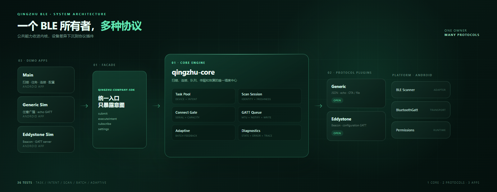
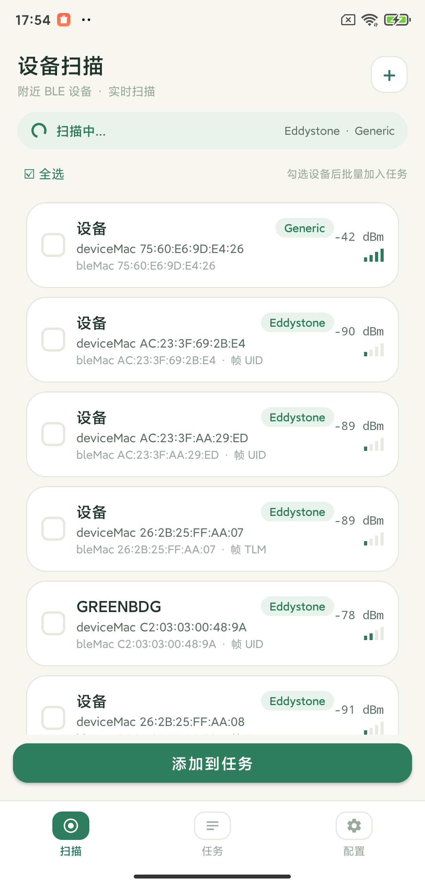
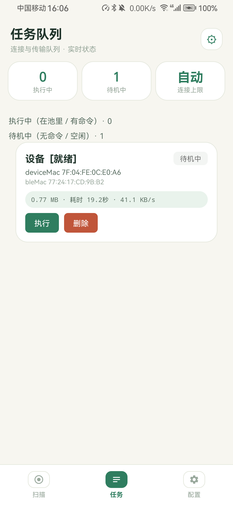
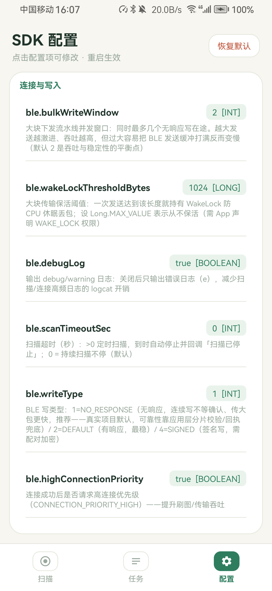
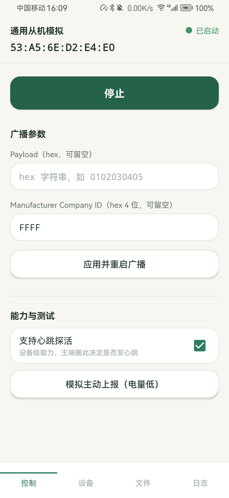
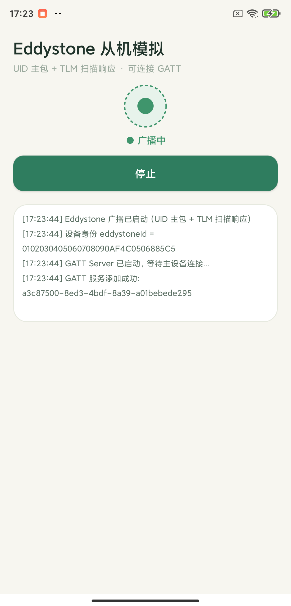

### [下载试玩（1 个主端 + 2 个从端）](#下载试玩) · [在线文档](https://qingzhu-ai-public.github.io/qingzhu-blue/)

# Qingzhu-BLE

[](https://developer.android.com)
[](https://gradle.org)
[](https://github.com/qingzhu-ai-public/qingzhu-ble-android)

青竹 BLE Android SDK，以任务为中心，提供扫描、自动寻人、连接、发送、接收、通知、MTU、批量设备调度、意图排队、超时重试和协议插件化能力；内部处理串行建连、传输窗口、地址轮换、心跳、断连恢复和迟到回调，可注册自己的设备协议。

> **你只需要把现有产品的设备协议告诉 AI，让它帮你接入 `ProtocolPlugin`。**
>
> 扫描、连接、服务发现、GATT 收发、超时、重试、意图队列、批量调度和异常恢复，底层已经处理好。你不需要再为每个产品重写一套 BLE 状态机。
>
> 给 AI 协议文档、帧格式、抓包或示例数据即可，不要让它猜协议。具体提示词见 [用 AI 接入](#0-用-ai-接入推荐先做)。

## 为什么做这套 SDK

写一个能跑的 BLE Demo 并不难：

```text
Scan → Connect → Discover Services → Write → Notify
```

但这只证明“一台手机、一台设备、一次理想操作”能跑通。进入真实项目后，问题会从另一层开始出现：多台设备同时连接、页面反复点击、设备休眠或换地址、任务中途取消、蓝牙栈返回 133/8/19、不同机型的行为差异，以及长时间运行后的资源泄漏。

大型 BLE 项目还有第二层问题：多套设备 SDK 并存。每套 SDK 都自带扫描、连接、重试、队列和错误模型，各自以为独占蓝牙资源；结果是重复实现、状态不一致、修复分散，而且新设备一接入就要再复制一套公共逻辑。

Qingzhu-BLE 的出发点不是再写一个薄封装，而是把这两类问题放进同一套架构里：

| 设计理念 | 解决的问题 |
|---|---|
| **任务式模型** | 业务只表达“这台设备要做什么”，SDK 管扫描、寻人、排队、连接、发送、取消、重试和收尾 |
| **统一资源调度** | 一个内核拥有扫描、建连、连接容量和传输窗口；串行建连、批量调度和迟到回调治理有唯一落脚点 |
| **异常治理** | 处理地址轮换、扫描假死、心跳失活、断连恢复、超时重试、取消后的旧回调污染 |
| **协议插件化** | 公共能力下沉到 core，设备差异上浮为协议插件；新增协议不改内核 |
| **可诊断性** | 任务自带状态、进度、结果、错误和意图终态，排查时知道卡在哪一步 |

这套设计的前提可以用一句话概括：

> BLE 资源在一个进程里是共享的，必须有明确的所有者；否则任何调度策略都无法生效。

因此它不是“又一个 BLE API 复制品”，而是一个面向批量通信和多协议治理的工程化 SDK 实验。

当前仓库仍是源码预览版：核心状态机和公开示例协议已经可构建、可测试，但长期稳定性、机型兼容性和多插件冲突治理仍需继续验证。

## 架构总览



> 一个 BLE 所有者，多种协议。公共能力收进 core，设备差异下沉到协议插件。

## 目录

- [为什么做这套 SDK](#为什么做这套-sdk)
- [架构总览](#架构总览)
- [下载试玩](#下载试玩)
  - [试玩 App 源码](#试玩-app-源码)
- [API](#api)
- [接入前提示](#接入前提示)
- [接入文档](#接入文档)
  - [0. 用 AI 接入](#0-用-ai-接入推荐先做)
  - [1. 添加依赖](#1-添加依赖)
  - [2. 配置权限](#2-配置权限)
  - [3. 初始化](#3-初始化)
  - [4. 扫描](#4-扫描)
  - [5. 提交任务](#5-提交任务)
  - [6. 连接](#6-连接)
  - [7. 发送数据](#7-发送数据)
  - [8. 任务状态与结果](#8-任务状态与结果)
  - [9. 意图排队与完成回调](#9-意图排队与完成回调)
  - [10. 取消与删除](#10-取消与删除)
  - [11. 多设备调度](#11-多设备调度)
  - [12. 自定义协议](#12-自定义协议)
- [构建](#构建)
- [测试](#测试)
- [Screenshot](#screenshot)
- [常见问题](#常见问题)
- [版本](#版本)
- [License](#license)

## 下载试玩

| 角色 | 文件 | 说明 |
|---|---|---|
| 主端 | [qingzhu-demo-main-v1.0-debug.apk](downloads/qingzhu-demo-main-v1.0-debug.apk) | 扫描、添加任务、连接、发送、意图队列、调度配置 |
| 从端 | [qingzhu-demo-sim-generic-v1.0-debug.apk](downloads/qingzhu-demo-sim-generic-v1.0-debug.apk) | Generic 可编程外设，任意广播 + echo GATT |
| 从端 | [qingzhu-demo-sim-eddystone-v1.0-debug.apk](downloads/qingzhu-demo-sim-eddystone-v1.0-debug.apk) | Eddystone Beacon + 可连接 GATT 外设 |
| 校验 | [SHA256SUMS.txt](downloads/SHA256SUMS.txt) | 3 个 APK 的 SHA256 |

三个 APK 都是 Debug 签名，Android 7.0+。

```bash
adb install -r downloads/qingzhu-demo-main-v1.0-debug.apk
adb install -r downloads/qingzhu-demo-sim-generic-v1.0-debug.apk
adb install -r downloads/qingzhu-demo-sim-eddystone-v1.0-debug.apk
```

试玩方式：

1. 主端装在手机 A；
2. 手机 B 装 Generic 或 Eddystone 从端，两个都装也可以；
3. 从端开启广播；
4. 主端扫描、连接、发送。

试玩包只装配 Generic 和 Eddystone 两个开源协议，不包含私有设备协议。

### 试玩 App 源码

| 角色 | 源码模块 |
|---|---|
| 主端 | [`qingzhu-demo-main`](qingzhu-demo-main) |
| Generic 从端 | [`qingzhu-demo-sim-generic`](qingzhu-demo-sim-generic) |
| Eddystone 从端 | [`qingzhu-demo-sim-eddystone`](qingzhu-demo-sim-eddystone) |

从端 App 不依赖 SDK，完全用 Android BLE API 模拟真实外设。

## API

* **[QingzhuSdk](qingzhu-company-sdk/src/main/java/com/qingzhu/sdk/QingzhuSdk.java)** - 开源门面，提供初始化、扫描、任务提交、调度配置和协议注册。
* **[QDevice](qingzhu-core/src/main/java/com/qingzhu/ble/sdk/core/device/QDevice.java)** - 扫描到的设备模型，包含 MAC、名称、RSSI、稳定身份、协议类型和 metadata。
* **[QCommand](qingzhu-core/src/main/java/com/qingzhu/ble/sdk/core/api/QCommand.java)** - 连接/发送命令，支持 JSON、字节、多附件、保持连接、连接参数和重连策略。
* **[QTask](qingzhu-core/src/main/java/com/qingzhu/ble/sdk/core/api/QTask.java)** - 任务句柄，一台设备对应一个任务，提供状态、进度、结果、错误、取消和删除。
* **[TaskState](qingzhu-core/src/main/java/com/qingzhu/ble/sdk/core/api/TaskState.java)** - 任务状态。
* **[TaskIntentResult](qingzhu-core/src/main/java/com/qingzhu/ble/sdk/core/api/TaskIntentResult.java)** - 意图被接收时的立即结果。
* **[TaskIntentStatus](qingzhu-core/src/main/java/com/qingzhu/ble/sdk/core/api/TaskIntentStatus.java)** - 单条意图的最终结果。
* **[ProtocolPlugin](qingzhu-core/src/main/java/com/qingzhu/ble/sdk/core/protocol/ProtocolPlugin.java)** - 协议插件接口，新设备类型通过它接入。

## 接入前提示

1. 设备只有一种类型：实现一个 `ProtocolPlugin`，初始化后注册即可。
2. 设备有多种类型：每种设备一个插件，扫描结果通过 `device.getProtocolType()` 区分。
3. 只给 MAC 也能提交任务：SDK 会先扫描寻人，找到后自动连接和发送。
4. 同一台设备只创建一个任务；后续命令通过 `QTask.executeIntent()` 提交。

## 接入文档

### 0. 用 AI 接入（推荐先做）

这是一个源码预览仓库，推荐先把工程拉到本地，再让 AI 读代码和 README，最后接入你的 App。

#### 克隆项目

```bash
git clone https://github.com/qingzhu-ai-public/qingzhu-ble-android.git
cd qingzhu-ble-android
```

#### 理解项目的提示词

复制到 Codex / Claude Code / Cursor / CodeBuddy 等工具：

```text
你是 Android BLE 工程师。请先不要修改代码，只阅读并理解这个仓库：
https://github.com/qingzhu-ai-public/qingzhu-ble-android

请按顺序阅读：
1. README 的「为什么做这套 SDK」「架构总览」「API」「接入文档」
2. qingzhu-company-sdk/src/main/java/com/qingzhu/sdk/QingzhuSdk.java
3. qingzhu-core/src/main/java/com/qingzhu/ble/sdk/core/api/QTask.java
4. qingzhu-core/src/main/java/com/qingzhu/ble/sdk/core/api/QCommand.java
5. qingzhu-core/src/main/java/com/qingzhu/ble/sdk/core/protocol/ProtocolPlugin.java
6. qingzhu-core/src/main/java/com/qingzhu/ble/sdk/core/QSdk.java

读完后用不超过 800 字回答：
- 这个 SDK 解决什么问题
- core、门面、协议插件分别负责什么
- 扫描、提交任务、连接、发送的调用顺序
- 接入一个自有设备协议时必须实现哪些方法
- 哪些能力已经实现，哪些仍是边界

不要先写代码，不要改公开仓库，先输出理解结果。
```

#### AI 阅读顺序

```text
README
  → QingzhuSdk（门面 API）
  → QTask / QCommand（任务和命令）
  → ProtocolPlugin（协议扩展）
  → QSdk（扫描、批次、订阅）
  → QTaskPool（意图、队列、重试）
```

### 1. 添加依赖

源码模块接入：

```groovy
// settings.gradle
include ':qingzhu-core'
include ':qingzhu-company-sdk'
include ':qingzhu-protocol-generic'
include ':qingzhu-protocol-eddystone'
```

```groovy
// app/build.gradle
dependencies {
    implementation project(':qingzhu-company-sdk')
}
```

本地 AAR 接入：

> 当前公开仓库只提供源码模块接入和试玩 APK；宿主 AAR 由内部工程打包，不在公开仓库发布。
>
> `qingzhu-company-sdk` 是唯一源码门面。

### 2. 配置权限

```xml
<uses-permission android:name="android.permission.BLUETOOTH_SCAN" />
<uses-permission android:name="android.permission.BLUETOOTH_CONNECT" />
<uses-permission android:name="android.permission.BLUETOOTH" android:maxSdkVersion="30" />
<uses-permission android:name="android.permission.BLUETOOTH_ADMIN" android:maxSdkVersion="30" />
<uses-permission android:name="android.permission.ACCESS_FINE_LOCATION" />
<uses-permission android:name="android.permission.ACCESS_COARSE_LOCATION" />
<uses-permission android:name="android.permission.WAKE_LOCK" />
```

Android 12 及以上动态申请 `BLUETOOTH_SCAN` 和 `BLUETOOTH_CONNECT`；Android 11 及以下通常需要定位权限并打开系统定位。

### 3. 初始化

```java
public class App extends Application {
    @Override
    public void onCreate() {
        super.onCreate();
        QingzhuSdk.init(this);
    }
}
```

`init()` 会初始化内核并注册 Generic、Eddystone 两个开源协议，重复调用幂等。

### 4. 扫描

```java
QingzhuSdk.startScan(new QSdk.ScanListener() {
    @Override
    public void onDevices(List<QDevice> devices) {
        for (QDevice device : devices) {
            String name = device.getName();
            String mac = device.getMac();
            String stableId = device.getStableId();
            int rssi = device.getRssi();
            String protocol = device.getProtocolType().getId();
        }
    }

    @Override
    public void onScanFailed(int errorCode, String message) {
        // 权限、蓝牙关闭或系统扫描失败
    }

    @Override
    public void onScanStopped(List<QDevice> devices) {
        // 定时扫描结束时的最终快照
    }
});
```

列表去重请使用 `getStableId()`，不要只依赖 MAC。地址轮换设备只有稳定身份不变。

扫描设置：

```java
QingzhuSdk.startScan(
        ScanOptions.builder()
                .setTimeoutMs(30_000)       // 30 秒后自动停止；0 = 持续扫描
                .setMinRssi(-80)             // 忽略更弱的设备
                .setNamePrefix("ESL")        // 名称前缀，大小写不敏感
                .addProtocol("generic")      // 只显示指定协议
                .addStableId("A1B2C3D4E5F6") // 只显示指定稳定身份
                .build(),
        listener
);
```

过滤只作用于 UI 回调，任务池仍然能看到完整广播，不影响自动寻人和重寻址。

停止扫描：

```java
QingzhuSdk.stopScan();      // 退订 UI 回调并停止底层扫描；任务需要寻人时仍可按需重新拉起
```

扫描状态：

```java
QingzhuSdk.setScanStateListener(scanning -> {
    // true = 扫描中；false = 已停止
});
```

### 5. 提交任务

已经拿到扫描设备：

```java
QCommand command = QCommand.builder()
        .send("{\"action\":\"echo\"}")
        .build();

QTask task = QingzhuSdk.submit(device, command);
```

只知道 MAC：

```java
QTask task = QingzhuSdk.submit("AA:BB:CC:DD:EE:FF", command);
```

这种任务会先进入寻人状态，SDK 找到设备后自动连接并发送，不需要业务自己先扫描再连接。

同一台设备重复 `submit` 会返回同一个任务，不会创建第二份连接。

### 6. 连接

```java
QCommand connect = QCommand.builder()
        .connect()
        .build();

QingzhuSdk.submit(mac, connect);
```

带连接参数：

```java
Map<String, Object> params = new HashMap<>();
params.put("deviceKey", "your-device-key");

QCommand connect = QCommand.builder()
        .connect(params)
        .build();
```

连接参数由协议插件解释，内核只负责传递。

### 7. 发送数据

JSON 指令：

```java
QCommand command = QCommand.builder()
        .send("{\"action\":\"echo\"}")
        .build();
```

JSON + 单块字节：

```java
QCommand command = QCommand.builder()
        .send("{\"action\":\"ota\"}", firmwareBytes)
        .build();
```

JSON + 多附件：

```java
Map<String, Object> attachments = new HashMap<>();
attachments.put("partA", bytesA);
attachments.put("partB", bytesB);

QCommand command = QCommand.builder()
        .send("{\"action\":\"write-parts\"}", attachments)
        .build();
```

发送后保持连接：

```java
QCommand command = QCommand.builder()
        .send("{\"action\":\"echo\"}")
        .keepConnected()
        .build();
```

默认发完断开，调用 `keepConnected()` 后保持连接。

### 8. 任务状态与结果

```java
QingzhuSdk.subscribe(new QSdk.TaskPoolListener() {
    @Override
    public void onChanged(List<QTask> tasks) {
        for (QTask task : tasks) {
            TaskState state = task.getState();
            int progress = task.getProgress();
            int sent = task.getSentBytes();
            int total = task.getTotalBytes();
            String result = task.getResult();
            String error = task.getError();
            int pending = task.pendingIntentCount();
        }
    }
});
```

| 状态 | 含义 |
|---|---|
| `UNKNOWN` | 只有 MAC，还没找到设备 |
| `READY` | 已找到设备，等待命令 |
| `SEARCHING` | 占位任务正在寻找设备 |
| `QUEUED` | 已取号，等待连接窗口 |
| `CONNECTING` | 正在建立连接 |
| `CONNECTED` | 已连接 |
| `SENDING` | 正在发送 |

失败后任务回到 `READY` / `UNKNOWN`，原因从 `getError()` 读取。

### 9. 意图排队与完成回调

提交意图并立即判断是否被接受：

```java
TaskIntentResult result = task.executeIntent(command);

switch (result) {
    case STARTED:           // 已开始执行
    case QUEUED:            // 进入待办队列
    case ALREADY_SATISFIED: // 例如已连接时再次连接
    case IN_PROGRESS:       // 已有操作进行中
    case BUSY:              // 待办队列已满
    case CLOSED:            // 任务已删除
}
```

需要每条命令的最终结果：

```java
task.executeIntent(nextCommand, (intentId, status, result, error) -> {
    switch (status) {
        case SUCCEEDED:
            // result 是设备回显，可能为 null
            break;
        case FAILED:
            // error 是失败原因
            break;
        case CANCELLED:
            // 任务取消、删除，或前序命令失败
            break;
    }
});
```

重复调用行为：

| 当前状态 | 新意图 | 行为 |
|---|---|---|
| 已连接 | 再连接 | `ALREADY_SATISFIED`，不重复建连 |
| 正在发送 | 再连接 | `ALREADY_SATISFIED`，发送完成后保持连接 |
| 正在连接 | 再连接 | `IN_PROGRESS`，合并连接意图 |
| 正在发送 | 再发送 | 进入待办队列，返回 `QUEUED` |
| 待办已满 | 再发送 | 返回 `BUSY` |
| 任意状态 | 删除任务 | 清空待办、终止发送、断开连接 |

每台设备默认排队 8 条发送意图：

```java
QingzhuSdk.setMaxPendingIntents(8);
```

回调在主线程执行。`BUSY` 和 `CLOSED` 不会注册回调。


### 10. 取消与删除

```java
task.cancel();  // 停止当前动作，清空待办，任务保留
task.delete();  // 彻底删除，断开连接，之后提交返回 CLOSED
```

取消和删除会给当前、待办和连接等待中的意图发送 `CANCELLED` 回调。

### 11. 多设备调度

```java
QingzhuSdk.setMaxConnections(0);        // 0 = 自动建议，1-N = 手动
QingzhuSdk.setMaxTransfers(1);          // 1 = 串行传输
QingzhuSdk.setMaxRetries(3);            // 连接/发送/寻人失败重试次数
QingzhuSdk.setMaxPendingIntents(8);     // 每设备待办发送数
QingzhuSdk.setConnectCallbackTimeoutMs(20_000); // GATT 连接回调兜底

int currentCapacity = QingzhuSdk.getConcurrency();
```

普通机型建议从 `setMaxConnections(0)` + `setMaxTransfers(1)` 开始；目标机型验证稳定后再提高传输并发。


### 12. 自定义协议

实现 `ProtocolPlugin` 后注册：

```java
QingzhuSdk.registerProtocol(new MyProtocolPlugin());
```

协议插件可声明识别器、稳定身份、扫描过滤、连接步骤、GATT 就绪钩子、心跳、默认配置和消息路由。

完整最小示例：

- [GenericProtocolPlugin](qingzhu-protocol-generic/src/main/java/com/qingzhu/protocol/generic/GenericProtocolPlugin.java)
- [EddystoneProtocolPlugin](qingzhu-protocol-eddystone/src/main/java/com/qingzhu/protocol/eddystone/EddystoneProtocolPlugin.java)

## 构建

环境：JDK 17+、Gradle 8.13、compileSdk 35、minSdk 24。

构建 3 个试玩 App：

```bash
./gradlew \
  :qingzhu-demo-main:assembleDebug \
  :qingzhu-demo-sim-generic:assembleDebug \
  :qingzhu-demo-sim-eddystone:assembleDebug
```

APK 产物：

```text
qingzhu-demo-main/build/outputs/apk/debug/qingzhu-demo-main-debug.apk
qingzhu-demo-sim-generic/build/outputs/apk/debug/qingzhu-demo-sim-generic-debug.apk
qingzhu-demo-sim-eddystone/build/outputs/apk/debug/qingzhu-demo-sim-eddystone-debug.apk
```

## 测试

```bash
./gradlew :qingzhu-core:testDebugUnitTest
```

覆盖重复连接、发送中连接、连续发送排队、队列满、取消、失败、删除和命令级回调。

## Screenshot

### 主端 App

| 扫描与协议识别 | 任务队列 | SDK 配置 |
|---|---|---|
|  |  |  |

| 命令面板 | 批量添加（只填 MAC） |
|---|---|
|  |  |

### 从端模拟器

| Generic 从端 | Eddystone 从端 |
|---|---|
|  |  |

> 所有图片来自本仓库提供的试玩 App 和模拟器。

## 常见问题

**扫描不到设备？**

检查蓝牙是否开启、运行时权限是否授予；Android 11 及以下还需要打开系统定位。

**为什么连接会慢？**

部分低功耗设备广播间隔长，系统 `connectGatt` 可能十几秒才回调。SDK 默认等待 20 秒，并在失败后等待新鲜广播再重试。

**为什么返回 BUSY？**

该设备已有发送任务，且待办队列达到上限。可以调大 `setMaxPendingIntents`，或在业务侧等待当前任务完成。

**为什么任务没有 FAILED 状态？**

失败后会回到 `READY` / `UNKNOWN`，具体错误写入 `getError()`；命令级最终状态通过 `TaskIntentStatus` 回调。

更多问题请查看 [文档站](https://qingzhu-ai-public.github.io/qingzhu-blue/)。

## 版本

| 版本 | 日期 | 说明 |
|---|---|---|
| `v1.0.0-preview` | 2026-11-17 | 首个公开源码预览；任务内核、意图队列、Generic / Eddystone 协议、试玩 APK |

## License

[MIT](LICENSE) © 2026 Qingzhu BLE SDK contributors

## Contribute

欢迎通过 GitHub Issues 提交问题和建议。提交代码前请先确认不包含任何私有协议、客户数据或业务 App。
